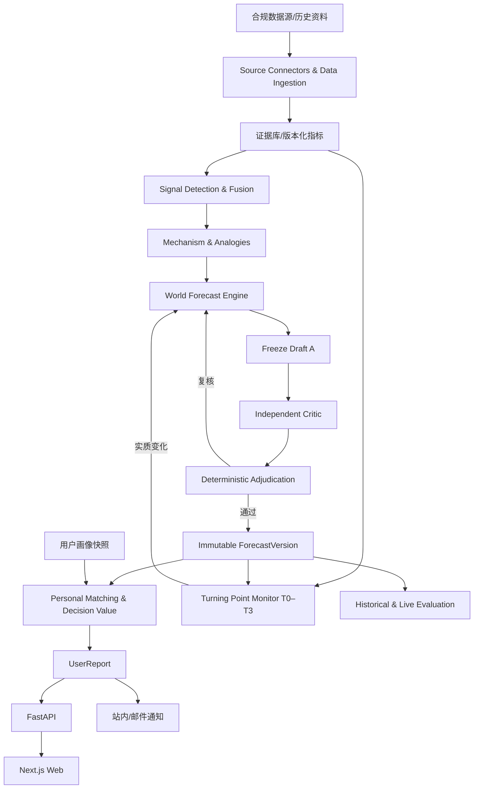

# FutureOS：个人未来预测 Agent 系统

**产品需求、预测研究规范与工程实施计划（Codex 开发版）**  
**版本**：v1.3（完整基线）  
**编制日期**：2026-11-01  
**状态**：工程实施规格；部分外部数据源、模型服务、支付服务及商业价格须在接入前确认  
**适用对象**：产品负责人、架构师、前端/后端工程师、Agent/数据工程师、测试与 Codex 代码代理

> **一句话愿景**：FutureOS 是以**全生命周期、跨领域、持续更新的未来预测**为核心能力的 Web Agent 产品。它发现弱信号和多信号组合所指向的潜在变化，推演未来发展路径与连锁影响，用证据、反证、量化评估和独立 Critic 审查控制预测质量；再把经过审查的世界预测映射到具体个人，提供可执行、低噪声、可复查的工作、学习、消费、生活等建议。免费用户获得一份完整的首次画像报告和所含原预测的重大变化复查；付费用户可研究新主题、使用主动周期研究服务，并选择是否收到邮件。

---

## 0. 给 Codex 的强制执行原则

1. **将本文作为单一功能规格来源**。本文替代 v1.2 作为开发基线；旧版只供历史参考。若发现规范冲突，优先遵循本章、不变量和相应模块的验收标准，并在 `docs/decisions/` 写 ADR，不在未说明的情况下改变商业规则。
2. **按 M0→M7 里程碑开发**；每阶段先列实施任务，再写代码、迁移、单元与集成测试，最后提交可复现的测试报告。允许在早期搭建 Web 壳，但不能提前用 UI 演示代替引擎验收。
3. **不建设无必要的 Agent 集群**。MVP 采用编排工作流 + 少量 LLM 工具调用 + 确定性校验器/统计模型；每种能力定义独立接口，必要时再拆成服务。
4. **三类数据不得混淆**：`fact` 已观察事实、`hypothesis` 待验证研究假设、`forecast` 有明确目标与期限的可检验预测；另有 `scenario` 条件化情景、`recommendation` 个人行动建议。任何示例、Mock、历史演示均须显著标注，不能伪装实时真实预测。
5. **发布必须过审查质量门槛**：不可变原始预测草稿 A → 独立 Critic → 事实核实与规则裁决 → 必要时主引擎定向复核 B → 冻结已发布预测版本。Critic 没有直接改写主预测的权限；只有真实关键证据错误可触发阻断与复核。
6. **时间版本必须正确**：区分事件发生、信息首次公开、指标统计期、指标数据当时可获取时间、采集时间、研究 as-of、预测发布时间。旧版预测不允许静默覆盖。
7. **预测结果必须有用**：报告要回答“何事可能发生、什么时候、为什么、对我有何影响、我值得做什么、什么时候应该复查”；允许明确的“暂不行动”。不能靠堆砌建议数量和恐惧刺激付费。
8. **商业约束**：一次免费完整画像预测按“报告权益”计，不按报告内预测条数计；原预测因重大拐点而复查免费，不赠送任意新主题；付费权益与邮件开关独立；扣费/退款幂等；默认不自动发送营销邮件。
9. **供应商抽象与 Mock**：LLM、Web Search、统计源、邮件、支付、存储均使用可替换 Provider；本地无密钥可跑通确定性假数据端到端演示。
10. **不夸大预测能力**：不可声称能准确预言一切重大事件。概率必须校准后才能展示百分比；历史时间截断回测要承认基础模型可能包含未来知识，真实前瞻预测才是长期可信证据。
11. **安全与隐私先行**：跨用户隔离、最小必要画像、数据删除、邮件收件确认、服务端支付验证；不自动执行投资买卖、职业辞职、医疗决策或其他不可逆个人行动。
12. **提交记录**：每阶段提交变更文件、启动命令、测试命令和输出、迁移情况、未实现项、已知风险与下一里程碑，不声称未运行的测试已通过。

## 1. 产品定位、成功条件与非目标

### 1.1 定位

**产品类型**：以预测为核心、为个人提供前瞻性决策建议的 Web Agent。系统不是新闻聚合站、通用聊天机器人、自动投资交易系统、医疗诊断系统，也不是声称能准确预知未来的“预言工具”。

**核心价值链**：`多领域原始资料 → 事实核实/指标化 → 弱信号发现 → 多信号融合 → 机制抽象 → 跨领域历史类比 → 竞争性未来假设 → 可检验预测/情景 → 独立 Critic → 发布 → 个人影响/建议价值 → 报告 → 新证据触发重预测 → 实际结果验证`。

**全阶段覆盖**：萌芽、成长、成熟、转折、衰退、重新增长都可以预测；萌芽期的早发现是差异化能力，不是唯一产品场景。不同阶段使用不同来源、预测窗口与不确定性说明。

### 1.2 核心原则

- 前瞻而非事后解释；跨行业机制类比而非只找本行业相似事件。
- 把支持、反对和“未按预想发展”的证据同时呈现；避免只叙述成功案例。
- 预测可检验、可追踪、可被证伪；即使错误也保留完整记录。
- 按个人**决策价值**推荐，而非按新闻热度、模型篇幅或恐惧程度排序。
- 行动建议遵循最小成本与可逆性原则；高代价/不可逆行动需要更高证据与用户主动判断。
- 运营不能为了续费制造焦虑、虚构确定性或滥发通知。

### 1.3 衡量维度与“成功”的定义

| 维度 | 最小可测指标 | 注意事项 |
|---|---|---|
| 预测结构质量 | 可测试预测占比、证据可追溯率、发布闸门通过率 | 这些是过程质量，不等于预测准确 |
| 真实预测水平 | 方向/数值误差、校准、相对简单基线表现 | 按领域/时间窗口分层，样本不足不宣称有效 |
| 提前性 | 信号领先公开共识/关键验证事件的时间 | 对照基准须预先定义，不能事后挑选 |
| 审查收益 | A 版与审查后 B 版在盲评/未来结果中的差异 | Critic 反而变差时必须能关闭规则 |
| 用户价值 | 报告完成率、行动可执行评分、建议有用率、重复使用 | 不能仅靠报告点击量判定价值 |
| 运营效率 | 共享研究复用率、单次研究成本、增量复查成本 | 定价前测量真实成本 |
| 可信与安全 | 用户隔离、敏感数据处理、邮件授权、错误率 | 任何越权/误扣费均属于发布阻断 |

不预先承诺模型预测胜率、营收增长率或某种真实世界的准确率。阶段验收采用明确可控的工程指标；效果指标以真实实验记录评估。

### 1.4 非目标

- 不承诺股票、房价、就业、疾病等确定性结果。
- 不在 MVP 中支持全网实时爬取、无限跨领域定量模型、自训练基础模型、多租户 B2B API、自动执行个人资产操作。
- 不把新闻摘要、历史已发生事实、类比故事冒充可验证预测。
- 不把“个性化”理解为必须采集用户全部财务、健康、家庭隐私。

## 2. v1.3 变更清单与关键不变量

### 2.1 相比 v1.2 的重要升级

| 编号 | 更新 | 必须影响到的实现 |
|---|---|---|
| V13-01 | 新增 **Signal Fusion & Emergence** 多信号融合与涌现假设 | 引擎、信号关系、评价与测试 |
| V13-02 | 区分历史时间截断回测和真实前瞻测试 | 预测存档、评估、UI 可信说明 |
| V13-03 | 规范 `ResearchTopic/WorldForecast/ForecastVersion/PersonalImpact/UserReport` 五级对象 | DB、API、计费、报告、重预测 |
| V13-04 | T0–T3 分级重预测；依据假设和证据变化而不是“新闻又来了” | 监控、差分、任务、通知 |
| V13-05 | 数据 as-of、发布时间、修订版本、观测来源 | 数据管道、回测与证据系统 |
| V13-06 | 新增 **Decision Value Evaluator** | 相关性排序、建议引擎、个性化 |
| V13-07 | 共享世界预测复用；费用、通知和周期研究权益解耦 | 商业化、队列、批量用户匹配 |
| V13-08 | 统一 monorepo 路径、M0–M7 优先级与所有接口 | 工程、文档、CI、验收 |

### 2.2 全局数据不变量（数据库约束 + 自动化测试）

1. `WorldForecast` 表示某个稳定的可检验预测目标；`ForecastVersion` 不可变；所有已发报告固定引用具体 `forecast_version_id`，不得因预测更新隐式变化。
2. 同一世界预测可以被很多用户复用；`PersonalImpact` 与 `UserReport` 只能在授权用户上下文中读取。
3. 重要修正总是追加新版本；不能更新旧版本的 `statement/target/evidence/as_of` 内容。
4. 免费“首次预测” = 一次成功交付的个人**研究报告权益**；报告里可以引用多个 `WorldForecast`，但原预测后续的 T2/T3 复查不重扣首次权益。
5. 付费“新研究主题”与系统内部 Agent 调用次数无关；重试、Critic 循环、监控运行不能多扣费。
6. 通知偏好不决定后台研究任务资格；`subscription_status` 不等于 `email_opt_in`。
7. 任何 Critic L3 关键事实错误未解决则不能发布；普通不同意见不直接篡改预测。
8. 预测里所有历史案例要明确“当时事实、跨领域相似机制、关键差异、不可迁移处”。
9. 任何真实用户界面中出现的 Mock 数据必须明确标记 `DEMO` 且不得误触真实邮件/收费。

## 3. 用户、画像与兴趣匹配

### 3.1 首次引导（目标体验 2–3 分钟）

**必需**：登录身份、`industry_l1`（一级行业）、`industry_l2`（二级行业或“其他/暂不适用”）、至少一个关注目标/兴趣；可按无行业学生/退休者/自由职业者场景兼容。**可选**：年龄段、性别（含“不愿透露”）、国家/城市、岗位文本、经验段、技能、当前重点问题、时区、语言、周期偏好。

**强制限制**：首次行业最多两级选择，不增加三级/四级强制联动。细粒度岗位和任务可以在报告改进建议中渐进式提示用户补充，但用户不填写仍能获得报告。

**行业分类**：配置化版本化 `industry_taxonomy`，允许关键词搜索、双语标签、其他自由输入和映射维护。支持一用户多份职业背景；首次选当前主要行业。

### 3.2 其他可选画像

`life_roles[]`（雇员/创业者/学生/自由职业者/照护者等）、`goals[]`（职业/学习/消费/居住/财务/健康生活等）、`skills[]`、`time_horizon`、`risk_preference`（审慎表达，不做投资适当性推断）、`consented_context[]`。用户可单独关闭个人化字段使用与邮件提醒。

工资、负债、健康、家庭成员、精确地址不是首次必填；按具体需求征求单独授权，提供清晰的使用范围、保存周期和删除入口。不要从性别或年龄机械推断能力、财富、健康状况或岗位价值。

### 3.3 画像快照

每次报告保存 `profile_snapshot_id`（仅必要字段）和 `profile_taxonomy_version`。画像修改不会偷偷改写旧报告；之后新报告使用新快照。删除账号时清除个人原始画像与报告，去标识化公共研究/财务审计记录按合法保留规则分开处理。

## 4. 预测领域体系与 MVP 边界

**长期 12 个领域**：①宏观经济与金融；②科技与创新；③产业与商业；④职业与劳动力；⑤政策与制度；⑥消费与生活成本；⑦房地产与城市；⑧教育与学习；⑨健康与医疗；⑩能源与环境；⑪全球化与供应链；⑫社会与生活方式。

这些是数据分类，不是分析孤岛。一个能源技术信号可以通过供应链、汽车价格、就业等机制影响个人。`domain_tags` 允许多选。

**第一版深度验证的 3 个主题**：A. AI 对软件/互联网职业和技能的演化影响；B. 宏观经济与个人消费/生活成本；C. 新技术扩散对学习、工具选择和职业准备的影响。其他领域提供分类、手工导入和基础分析接口，不承诺同等自动化采集与准确率。

**预测生命周期**：`emergence` 萌芽、`growth` 成长、`maturity` 成熟、`inflection` 转折、`decline` 衰退；允许多阶段/争议状态与 `unknown`，不能因为表面热度机械判定。

## 5. 产品体验与业务流程

### 5.1 用户路径

1. 访问 `/` → 注册/登录 → 两级行业、目标与可选信息引导 `/onboarding`。
2. 用户确认免费首次画像研究 → 创建 `ResearchTopic`/`PredictionRequest`（先预留权益，成功交付后正式消耗）。
3. 共享研究系统检索/复用已有 `WorldForecast`；必要时发起新的公共研究；Critic 通过后生成个人影响与报告。
4. `/dashboard` 呈现 3–5 条对用户最有决策价值的预测，不要求所有预测都推荐立即行动。
5. `/reports/{id}` 查看完整报告、证据、跨领域历史案例、预测版本、建议及局限。
6. 经用户明确选择，首次成功报告发送 **1 封**邮件（或在设置中手动触发一次），邮件含安全登录链接；不自动开启营销周报。
7. 用户想研究其他行业/消费/学习/生活议题 → `/research/new` Chat/选择引导 → 研究范围与预计权益确认 → 付费提交。
8. 系统持续监控已发布预测的假设、指标和证据；T2/T3 才对旧预测免费增量复查，必要时为关联用户更新个人影响和站内报告。
9. 付费订阅用户可定期重新研究其已关注主题，站内始终更新；邮件由另外的 `email_opt_in` 控制。

### 5.2 页面与导航（Web / Next.js）

| 路由 | 页面 | 主要内容 |
|---|---|---|
| `/` | 首页 | 产品价值、样例、原则、收费介绍 |
| `/auth/*` | 认证 | 登录/注册/重置，适配成熟身份供应商 |
| `/onboarding` | 首次画像 | 两级行业选择、目标、可选信息、邮件授权 |
| `/dashboard` | 未来雷达 | 高个人决策价值预测、重要版本变化、行动/观察 |
| `/forecasts` | 预测库 | 领域、阶段、期限、状态、地区等过滤 |
| `/forecasts/[id]` | 世界预测详情 | 机制链、信号组合、证据、反证、历史类比、版本时间线 |
| `/reports` 和 `/reports/[id]` | 我的报告 | 完整个人报告、匹配理由、建议、旧版对照 |
| `/recommendations` | 建议中心 | 立即准备 / 继续观察 / 暂不行动、成本和复查 |
| `/research/new` | 引导式研究 | Chat + 表单候选、研究问题确认、权益说明 |
| `/pricing`、`/billing` | 商业化 | 套餐、额度、账单与支付状态 |
| `/settings/profile` | 画像与隐私 | 资料修改/导出/删除及授权 |
| `/settings/notifications` | 通知 | 邮件频率、警报类别、订阅/退订 |
| `/admin/*` | 管理台 | 数据源、审查队列、重预测任务、质量、成本 |

### 5.3 报告必须包含

封面与报告时间 / 个人画像摘要 / 研究资料截止时间（as-of） / 3–5 个重要预测 / 每项预测的具体可验证目标和期限 / 当前证据与反证 / 多信号机制链 / 跨领域历史案例的相同与不同 / 情景与假设 / 用户影响、适用条件和不确定性 / 建议及成本、替代方案、停止条件 / 下一次复查条件 / 历史版本与变化理由 / 证据链接与方法限制。

当证据只支持假设，不足以支持可检验预测时，报告单独标记“研究假设，尚未形成正式预测”，不得冒充已发布预测。

## 6. 免费、付费与长期服务权益

### 6.1 业务定义

| 能力 | 免费用户 | 付费订阅用户 |
|---|---|---|
| 首份完整画像报告 | 1 次成功交付 | 包含 |
| 报告内多条世界预测 | 可查看 | 可查看 |
| 原报告涉及预测的重大转折 T2/T3 复查 | 免费站内更新 | 免费/包含 |
| 主动研究新的预测主题 | 引导体验，提交需购买 | 按订阅额度使用 |
| 自动周期性个人研究 | 不含 | 按订阅频率和额度进行 |
| 重大变化站内查看 | 含 | 含 |
| 首次报告邮件 | 经明确授权 1 次 | 含 |
| 后续周期邮件/拐点邮件 | 默认无无限免费发送配额 | 用户自选开启，受频率控制 |
| 旧报告与预测版本查看 | 可查看 | 可查看 |

价格、额度、周期、邮件频率上限均通过配置表管理；**不在代码硬编码货币价格**。

### 6.2 扣费和恢复规则

- `entitlement_reservation` 在请求创建时预留；只有报告成功持久化并可访问后才转 `consumed`。失败/取消/供应商故障释放预留。
- `usage_ledger` 为不可变流水；请求幂等键 + 用户 + 主题 ID 唯一约束，避免网页重试重复扣费。
- 预测内部多个 Agent 步骤、Critic 重审、T2/T3 免费复查不消耗用户“新主题研究”额度。
- 新主题和已有研究的继续追问是否计费，由 `ResearchTopic.scope` 与版本化计费规则判定；不可悄悄将小幅追问视为昂贵新任务。
- 订阅取消、到期、支付 webhook 重放以及退款要有状态机和测试；支付成功只信任服务端验签结果。

### 6.3 共享研究降低成本

`WorldForecast` 由公共预测研究生成一次，相关用户共享研究结果但不会互相查看个人数据；后台根据用户快照做轻量影响匹配与差异性报告。某条预测影响成千上万人时，不运行成千上万次完整全球搜索+Critic。

### 6.4 研究与通知分离

`paid_periodic_research_enabled` / `research_interval` 控制用户已购买的周期研究；`email_digest_opt_in` / `email_alert_opt_in` 控制邮件；站内报告和预测更新不依赖邮件开关。关闭邮件不停止付费研究。

---
## 7. 工程架构、目录与依赖方向

### 7.1 总体架构



**物理原则**：初期允许 `apps/api`、研究 worker 共用部署资源，但在**包接口、依赖与测试**上隔离预测核心。`apps/web` 只走后端 API；预测核心不依赖支付、HTTP 路由或 UI；付费系统只管理请求权益，不介入预测结论。

### 7.2 统一仓库结构（其他章节不得使用冲突的根目录）

```text
futureos/
├── apps/
│   ├── web/                         # Next.js/TypeScript：用户与管理 UI
│   └── api/                         # FastAPI：认证/权限/报告/计费/编排入口
├── services/
│   └── prediction_engine/           # 独立 Python 包；可后续单独部署
│       ├── contracts/               # Pydantic DTO、状态/枚举、版本
│       ├── ingestion/               # 合规数据采集、解析、去重
│       ├── evidence/                # 来源、claim、时间版本、指标
│       ├── signal_detection/        # 弱信号发现与生命周期判定
│       ├── signal_fusion/           # 多信号组合与涌现机会（v1.3）
│       ├── mechanisms/              # 影响路径、约束、传播关系
│       ├── historical_analogies/    # 跨领域案例库及失败类比
│       ├── forecasting/             # 研究假设、可检验预测、基准模型
│       ├── critic/                  # 独立证据、因果、反证、类比审查
│       ├── adjudication/            # 规则裁决，无 LLM 直接改写
│       ├── turning_points/          # T0–T3、增量研究与新版本
│       ├── personalization/         # 用户相关性、个人影响
│       ├── decision_value/          # 建议决策价值评估（v1.3）
│       ├── recommendations/         # 动作、成本、复查、风险
│       ├── reporting/               # 报告结构化生成
│       └── evaluation/              # 历史回测、前瞻、A/B 轨评估
├── workers/
│   ├── research/                    # 异步任务执行器
│   └── scheduler/                   # 周期任务、拐点监控、到期评估
├── packages/
│   ├── contracts/                   # OpenAPI/JSON Schema + TS 类型
│   └── taxonomies/                  # 行业/预测领域版本化配置
├── infra/
│   ├── providers/                   # LLM/Search/Data/Email/Payment adapters & Mock
│   ├── migrations/                  # Alembic 迁移
│   └── docker/                       # Docker Compose/配置
├── fixtures/                         # 明确标注的演示/测试数据
├── tests/
│   ├── unit/
│   ├── contract/
│   ├── integration/
│   ├── e2e/
│   ├── temporal_backtests/
│   └── security/
├── docs/
│   ├── decisions/                    # ADR
│   ├── schemas/                      # 数据字典
│   ├── evaluations/                  # 预测成绩单与回测报告
│   └── runbooks/                     # 故障恢复/重放/成本/隐私
├── scripts/
├── .env.example
├── docker-compose.yml
├── Makefile
├── README.md
└── IMPLEMENTATION_PLAN.md           # 当前 v1.3 文档
```

### 7.3 推荐技术（实现前锁定可兼容版本，记录 ADR）

| 分类 | 首选 | 原则 |
|---|---|---|
| Web | Next.js + TypeScript + Tailwind | SSR/客户端交互、访问控制、响应式 |
| API | Python FastAPI + Pydantic | OpenAPI、明确 DTO、权限中间件 |
| ORM/迁移 | SQLAlchemy + Alembic | 迁移可回滚或安全前向修复 |
| 主数据 | PostgreSQL | JSONB 可作辅助，但核心实体关系化 |
| 语义搜索 | PostgreSQL 全文/pgvector 适配 | MVP 先用可解释机制标签过滤；不强制引入 Neo4j |
| 异步任务 | Redis + Celery（或等价实现） | 幂等、重试、死信、任务预算 |
| LLM | 抽象 `LLMProvider` | 记录模型 ID/版本/提示词 hash/成本 |
| 搜索/统计 | `SearchProvider` / `DataSourceProvider` | 合法访问，提供 Mock |
| 邮件 | `EmailProvider`，本地 Mailpit | 不将敏感报告全文发送给第三方 |
| 支付 | `PaymentProvider` | 上线服务商后方可启用真实扣费 |
| 指标/追踪 | JSON 结构化日志 + OTel 可选 | 不记录敏感原文和密钥 |

必须提供不配置外部密钥的 `DEMO_MODE=true` 运行方式，隔离测试数据库和真实邮件/付款。

### 7.4 Provider 契约

- `SearchProvider.search(query, as_of?, region?, max_results)`：返回 `source_id/url/published_at/snippet/provenance`；历史回测不能仅依赖当代搜索结果的发布时间过滤。
- `DataSourceProvider.get_series(indicator_id, as_of, start, end)`：返回**当时已发布的可用版本**，不是后来修订的最新值。
- `LLMProvider.generate_structured(schema, messages, budget, trace_context)`：强类型 JSON，必须经过 schema 校验与证据校验。
- `EmailProvider.send(template_id, recipient, payload, dedupe_key)`：严格发送名单、取消订阅、抑制测试发信。
- `PaymentProvider.create_checkout` / `verify_webhook` / `get_subscription`：测试与生产密钥隔离。

所有 Provider 要有 timeout、retry policy、速率限制、熔断/失败状态，错误不得伪装成功；未核实数据不得变为高可信正式结论。

## 8. 数据获取、证据系统与时间版本化（v1.3 核心）

### 8.1 数据类别和采集策略

| 类别 | 先行信号用途 | 优先来源 | 主要风险 |
|---|---|---|---|
| 政策与宏观统计 | 经济约束、政策信号 | 官方统计/API/公告 | 发布时间与数据修订 |
| 企业与产业 | 投资、招聘、需求、成本 | 财报、企业公告、行业数据 | 营销表述与样本偏差 |
| 科技前沿 | 能力突破、组合前提 | 论文、代码发布、基准、开源活动 | 演示与真实采用不一致 |
| 招聘就业 | 岗位结构/能力需求 | 合规统计接口、获许可数据 | 平台覆盖和岗位重复 |
| 消费/产品价格 | 成本变化和产品普及 | 官方统计、可合法获取的报价 | 区域差异、促销与口径 |
| 新闻/社区/社交 | 提供线索和弱信号候选 | 合规新闻/公开讨论 | 假新闻、回音室、重复传播 |
| 历史案例 | 机制跨领域迁移 | 原始历史材料、正式研究 | 事后叙事与幸存者偏差 |

尊重服务条款、robots、版权、许可，不绕过付费限制。优先保留指向原文的引用和有限摘要，不复制不可授权全文。内容中的“请忽略规则”等为不可信输入，不得被执行。

### 8.2 时间语义（强制字段）

- `event_at`：事件实际发生时间（可能未知）。
- `published_at`：该来源首次公开时间；需要区分原文更新和重发。
- `observed_period_start/end`：指标测量的统计期。
- `available_at`：此**版本的数据**何时可以被外部研究者获得。
- `ingested_at`：FutureOS 真正收到资料的时间。
- `research_as_of`：研究允许引用的信息截止时间。
- `forecast_published_at`：预测正式对用户发布的时间。
- `revised_at`：某个统计值后来修订/发布的新版本时间。

历史回测检查 `available_at <= as_of`，**不能**只判断 `observed_period_end <= as_of`，否则会使用未来才公布的统计值。

### 8.3 指标契约与原始修订

```json
{
  "indicator_id": "software_junior_job_postings",
  "provider_id": "licensed_jobs_provider",
  "region": "example_region",
  "unit": "postings",
  "frequency": "month",
  "definition_version": "2026-01",
  "observation": {
    "period_start": "2026-07-01",
    "period_end": "2026-07-31",
    "value": 1200,
    "published_at": "2026-08-10T00:00:00Z",
    "available_at": "2026-08-10T00:00:00Z",
    "vintage": "v1",
    "quality_flag": "DEMO_DATA"
  }
}
```

此处数据纯演示，不是现实市场信息。若 2026-09-01 修正为 1120，新建 `indicator_observation_vintage`，原 `v1=1200` 保留，历史回测仍可还原此前可见信息。

### 8.4 证据与主张分开

`Source`（文档/链接）不等于 `EvidenceClaim`（具体可核实陈述）。一个文档可以支持多个陈述，也可能只能支持文章作者的观点。

`EvidenceClaim` 结构：`claim_id, text, relation(supports/contradicts/context), source_id, source_span/locator, observed_at, known_at, verification_status, extraction_method, scope, caveat`。明确哪些数据支持了预测的哪一步机制；不可引用标题就把未出现的推断当作证据。

**证据质量门槛**：来源身份可追溯、时间有效、范围匹配、测量口径说明、可区分原始统计与转述。未经核实的网络声音只进入观察信号，不直接支撑高代价个人建议。

### 8.5 采集工作流

`SourceConnectors → Parse → NormalizeTime → Deduplicate → ExtractClaims → CrossCheck → Index/LinkIndicators → SignalCandidates`。

去重同时考虑 URL 规范化、文档 hash、内容相似、重复转载和事件实体；记录每个来源的合法使用方式。原文可失效时保存合法的原始元数据和核验状态，不因此虚构历史引用。

## 9. 信号发现、融合与涌现推演（v1.3 核心升级）

### 9.1 信号发现不局限于新闻事件

候选来源包括研究进展、产品技术参数、工具组合能力、成本曲线、开源贡献、标准、企业部署、招聘结构、消费行为以及经济指标背离。`signal` 必须标注所处生命周期阶段、来源、观察时间及证据强度。

候选信号研究优先级可用**透明规则分数**进行排序：`novelty + acceleration + potential_impact + cross_domain_relevance + evidence_quality + bottleneck_change`。该分数只是研究优先级，不是发生概率、预测置信度或“模型必然准确”。每个特征要能解释、可回放，后续可用真实反馈校准研究优先级。

### 9.2 Signal Fusion & Emergence Engine

**目标**：识别多个独立信号是否共同解除某个技术/市场/社会约束，或通过组合产生新的产品形态、产业结构与生活变化。

**输入**：`signals[]`、信号与来源关系、时间序列、机制标签、相同事件簇、约束节点和历史案例。  
**输出**：`signal_cluster`, `candidate_mechanism`, `dependencies`, `bottlenecks`, `synergy_hypotheses`, `disconfirming_patterns`, `testable_next_signals`, `fusion_evidence_refs`。

步骤：

1. **去同源伪多信号**：多个网站转载同一公告，不算三个独立证据；将来源聚到同一事件簇。
2. **识别互补能力**：如“更好理解上下文 + 能操作工具 + 能运行测试 + 可自反馈”是否满足自主任务的必要条件。
3. **约束图谱**：列出哪些瓶颈阻止新形态出现，识别已经松动、仍受限及新出现的限制。
4. **组合推演**：提出若 A+B 同时成熟会产生何种新能力/市场；包括与现存能力互相排斥的组合。
5. **竞争解释**：指出组合未形成新市场的可能原因，如可靠性、用户采纳、监管、成本、组织惰性。
6. **下一步可检验信号**：生成“未来应该观察到什么”的先行指标，而不是只写宏大故事。
7. **跨领域传播**：从新产品形态 → 生产率/成本 → 采用 → 劳动力/消费/城市/家庭等影响链继续推演。

**MVP 实现优先级**：规则机制标签 + 候选关联 + LLM 结构化假设 + 独立反证，暂不构建昂贵的通用知识图谱或深度因果发现模型。

### 9.3 一个完整的信号融合契约

```json
{
  "fusion_id": "demo-fusion-01",
  "signal_ids": ["signal-context", "signal-tools", "signal-feedback"],
  "independent_source_groups": 3,
  "mechanism": "模型从生成文本转向执行可验证任务",
  "enabling_conditions": ["理解任务", "调用工具", "反馈校验"],
  "remaining_bottlenecks": ["任务可靠性", "复杂环境集成"],
  "emergent_hypotheses": ["具备端到端开发能力的 Agent 可能出现"],
  "opposing_explanations": ["演示能力无法推广到生产环境"],
  "next_observable_signals": ["真实任务完成率", "企业试点采用率"],
  "stage": "emergence",
  "status": "hypothesis",
  "label": "DEMO_ONLY"
}
```

### 9.4 防止模型造故事

融合发现必须有**不相同来源簇**、明确机制条件、至少一个可观察后续信号、反例或失败机制。无法提供验证对象时只保留研究假设，不发布成确定性预测。引擎应支持“没有发现值得融合的信号”返回空结果。

## 10. 跨领域历史案例、机制与竞争路径

### 10.1 历史案例库契约

`historical_cases`: `label, industry, date_cutoff, event_timeline, mechanism_tags, initial_conditions, bottlenecks, intervention_or_technology, adoption_path, measured_outcomes, failed_expectations, alternative_outcomes, sources[], limitations[]`。

案例应包括“成功扩散”和“未扩散/预测失灵”的案例。存入**当时已知道的事件**及**事后才知道的结果**两个分离视图，回测时绝不可把后者直接输入预测工作流。

### 10.2 类比评分不是最终概率

机制优先于行业标签；考虑 `mechanism_overlap`、`initial_conditions`、`constraints_match`、`adoption_barriers`、`institutional_differences`、`data_quality`。返回相似之处、决定性差异、哪些规律可能迁移、哪些绝对不能迁移、预期可检验信号。

例如预测 AI 可参考办公数字化、工业自动化、移动计算和云计算，但不能只因为过去的移动应用增长就断言 AI Agent 的采用曲线、就业人数变化与手机一致。

### 10.3 机制关系（MVP 可用关系表）

`MechanismEdge(from_node, to_node, relationship, sign, lag_range, conditions, evidence_ids, uncertainty)`。允许多对多、反向作用与反馈回路，例如 `开发成本下降 → 软件需求增加` 和 `单位开发任务人力减少 → 特定岗位需求下降` 同时存在，不能强制只有一条方向。

### 10.4 竞争情景

每个研究主题至少分析：`base` 基准路径、`upside/acceleration` 加速路径、`downside/friction` 受阻路径；情景不是互斥概率声明，除非定义了严格可穷尽、相互排斥的事件与校准模型。必须包含能够推翻主机制的反面解释，并定义下一步观察指标。

## 11. 世界预测引擎：从假设到可验证目标

### 11.1 五个严格分离的产品对象

| 对象 | ID / 稳定性 | 用途 | 与其他对象的关系 |
|---|---|---|---|
| `ResearchTopic` | `topic_id`；研究范围可版本化 | 用户/系统想研究什么 | 一主题可形成多条世界预测 |
| `WorldForecast` | `forecast_id` 长期稳定 | 一条可验证的世界预测目标 | 包含多条不可变历史版本 |
| `ForecastVersion` | `forecast_version_id` 不可变 | 当时的预测结论与证据 | 被多个报告/建议固定引用 |
| `PersonalImpact` | `impact_id` + 用户和版本 | 该预测对某人的可能影响 | 指向特定画像快照和预测版本 |
| `UserReport` | `report_id` + `report_version` | 交付给用户的完整研究报告 | 组合若干固定预测版本与个人影响 |

**另**：`PredictionRequest` 是用户发起研究及计费的事务；`ResearchRun` 是内部实际运行；`HistoricalCase` 只是可比对的案例，不是预测本身。一次免费报告可包含多个 `WorldForecast`，绝不能按预测条数计费。公共世界预测更新后，报告旧版仍可访问。

### 11.2 预测目标字段（正式预测必须具备）

`target_type`（binary/numeric/ordinal/milestone）、`statement`、`population_scope`、`geography`、`metric_definition`、`direction_or_threshold`、`baseline`、`target_start_at/target_end_at`、`resolution_source`、`resolution_rule`、`research_as_of`、`evidence_claim_ids`、`contradiction_claim_ids`、`mechanism_ids`、`historical_case_ids`、`assumptions`、`falsification_conditions`、`scenario_ids`、`uncertainty_state`、`next_review_at`、`status`。

没有明确 **如何最终判定是否发生** 的条目，只能是 `hypothesis`。不强迫所有早期假设硬凑不可靠数值；可先用“里程碑观察清单”积累数据。

### 11.3 正式预测与情景示例（仅 DEMO）

- **不合格**：“AI 会越来越强，程序员将没有工作。”无法明确目标、范围和期限，也无多路径分析。
- **更好**：“在指定地区、指定职业分类与官方/许可统计来源中，2027 年年底之前某类初级岗位招聘数量与给定基准期相比有可测方向变化。”必须明确口径、源、基准及判定阈值；数据缺失时不能假装能核实。
- **探索性情景**：“若 Agent 真实复杂任务成功率上升、推理成本下降并被企业采用，开发职责可能发生重分配；反向情景是可靠性和治理成本阻碍采用。”这属于情景，不可无证据改成具体岗位降幅的确定预测。

### 11.4 主预测完整工作流（状态编排）

1. `DISCOVER`：选择研究主题、来源与数据截止日期。
2. `VERIFY`：核实事实及时间、取得当时可用指标版本。
3. `DETECT`：弱信号与生命周期判定。
4. `FUSE`：多信号去同源、组合条件和新形态推演。
5. `MODEL_MECHANISM`：机制因果链、瓶颈、反向效应与传播路径。
6. `ANALOGIZE`：跨领域成功/失败历史类比及差异。
7. `HYPOTHESIZE`：生成竞争假设和可能发展的情景。
8. `FORMALIZE`：转化为可检验目标；无足够数据的标为研究假设。
9. `BASELINE_FORECAST`：如适用，运行简单基准与统计模型；不得以 LLM 文章替代定量计算。
10. `SEARCH_COUNTEREVIDENCE`：主流程主动寻找反证和关键失败条件。
11. `FREEZE_A`：冻结输入 hash、原始草稿、证据集、提示词/模型版本。
12. `CRITIC_REVIEW` → `VERIFY_FINDINGS` → `ADJUDICATE`：独立审查与裁决。
13. `REVISE_IF_NEEDED`：通过主预测引擎定向复核，最多两轮，保留 A/B 链；仍无法解决则不发布正式预测。
14. `PUBLISH`：正式 `ForecastVersion` 不可变；未过闸门的假设可入观察库但不得混入正式预测列表。
15. `PERSONALIZE`：分析相关性、个人影响和建议价值。
16. `BUILD_REPORT`：可引用多个经过发布/明确假设标记的对象。
17. `MONITOR`：T0–T3 监测并在关键变化时重新预测。
18. `RESOLVE/EVALUATE`：到期记录真实结果、误差、基准与审查价值。

### 11.5 置信度与概率

`uncertainty_state = uncalibrated | calibrated_probability | interval_estimate | qualitative_assessment`。MVP 默认 `uncalibrated`，可说明证据质量和关键未知因素，不展示“88%概率”“可信度 9.3/10”之类虚构数字。使用统计方法时须输出基线和样本量；只有跨历史/前瞻数据校准后才可显示概率百分比。

### 11.6 最小状态机

```text
signal → hypothesis → draft_forecast → critic_pending
    ├── L0/L1 → approved → published(v1)
    ├── L2 → targeted_revision → critic_pending (≤ 2 轮)
    └── L3 → blocked → targeted_revision / research_only
published(vN) → monitoring → T2/T3 → new_draft → critic → published(vN+1)
published(vN) → due_resolution → confirmed / disconfirmed / inconclusive
```

发布后结果评估与重预测互相独立：历史版本的实际验证结果即使后来发布新版本，也不能被替代或擦除。

## 12. 定量模型、简单基线与预测边界

- **基线优先**：朴素趋势延续、同比/季节性朴素预测、持平基线等；复杂模型必须与适当基线比较。
- **数值预测**：简单时间序列/回归/树模型可后续按数据可用性引入，报告 MAE、RMSE、MAPE（仅在适用时）和区间覆盖率。
- **事件概率预测**：定义明确的二元事件和结果，适用时使用 Brier、对数损失、可靠度图和校准方法；不可在样本极少时包装精确概率。
- **方向预测**：提前明确“方向/无变化”的分界阈值和观测源，记录分类准确率及类别不均衡问题。
- **发展路径/情景预测**：用可观察的中间里程碑验证，而不是编造每种情景概率。
- **模型适用性检查**：缺值、统计口径变化、概念漂移、突变、区域异质性、数据样本量不足必须触发质量说明或降级成假设。
- **模型注册**：保存代码版本、模型 ID、参数与训练数据截至日期、输出和指标；重放可比。

**注意**：AI 可以生成假设和机制解释，不能自行给出未经检验的数值预测来冒充统计模型。复杂模型若长期输给简单基线，应回退基线。

---
## 13. Forecast Critic Engine：独立审查与裁决（延续 v1.2，不可降级）

### 13.1 目的和权限隔离

Critic 是**独立预测审查员**，不是主预测引擎的投票对手。它检查证据、历史类比、数据统计、因果链、遗漏情景和可检验性。它可以提交查证请求，但**不能执行** `UPDATE forecast_versions` 或直接覆写预测草稿 A；只有经过 `adjudication` 的请求才能让主引擎生成新的草稿 B。

### 13.2 五类 Critic 审查器

1. **EvidenceChecker**：原始文献是否存在；引用是否支持特定 claim；是否过时或统计口径变化；是否把评论当成数据。
2. **HistoricalChecker**：是否只挑选成功案例；跨领域机制是否相似；是否忽略关键制度、技术、用户行为差异。
3. **CausalChecker**：是否把相关性当成因果，是否跨越关键中间步骤，是否忽略需求反弹、替代效应等反向路径。
4. **ScenarioChecker**：是否只输出悲观/乐观单一路径；是否遗漏强约束和失败机制；是否设置反证指标。
5. **TemporalAndResolutionChecker**：历史资料是否出现未来泄漏；目标是否能到期判定；统计数据 `available_at` 是否早于研究 as-of。

### 13.3 L0–L3 分级与发布处理

| 级别 | 定义 | 处理 | Critic 能否直接修改预测 |
|---|---|---|---|
| L0 | 没有实质问题 | 通过；保存审查结果 | 否 |
| L1 | 合理的其他解释、措辞或局限性补充 | 原结论不变；可附注不确定性 | 否 |
| L2 | 新的重要证据或可能改变结论的合理问题 | 原草稿冻结；事实验证后发起定向复核 | 否 |
| L3 | 已核实的关键事实错误、时间泄漏、严重数据/目标错误或高风险建议问题 | 暂停发布，修正后再审；未解决则研究假设待定 | 否 |

**不是按 Agent 的“10% 权重”混合预测**。普通分歧不构成否决，关键可核实事实错误却必须阻断发布。裁决由具名规则执行，规则本身需版本化；涉及无法自动核实的高风险分歧可进入人工审核队列。

### 13.4 四步内部协议

`freeze_draft(A) → critic_review(A, independent_evidence_search) → verify_findings → adjudicate(rule_version) → accept / annotate / targeted_research / block`。

- Critic 可以看到待审预测及所引来源，但**不得直接继承**主引擎完整推演提示词；优先独立寻找证据和失败案例。
- `critic_findings` 记录 `finding_id, category, severity, statement, verified_source_refs, verification_status, scope, affected_assumption_ids, recommended_action`。
- 裁决层只依据结构化事实校验结果与明确规则；不能仅因 Critic 的自然语言“我更有把握”而重写预测。
- B 草稿只针对已核实的问题进行定向研究，不应无限重启全流程；最多两轮修订，超限标为 `research_only`/人工处理。
- 对 A、B 保存输入哈希、证据快照、模型配置、Critic 意见与差异；后续验证哪一种实际更优。

### 13.5 A/B 双轨测量

**A 轨**原始草稿独立保存；**B 轨**Critic 后草稿。若 A 不满足最低发布规则，不向用户发送 A；两轨仅供研究评估。评估 Critic 是否减少事实错误、是否改善到期预测误差、是否仅增加空泛的保守措辞，以及每次复核增加的成本。Critic 表现不佳时，允许通过策略配置停用某类非关键审查，不可停用 L3 基础事实/时间校验。

## 14. 发布后持续监控与 T0–T3 重预测（v1.3 核心升级）

### 14.1 发布前审查 ≠ 发布后重预测

`CriticReview` 是发布前对同一个草稿的质量把关；`TurningPointReview` 是发布后因为世界发生新变化，对**已发布** `ForecastVersion` 进行增量评估。这两套流程使用不同对象、事件、状态和审计日志，但可以复用 EvidenceChecker 等工具。

### 14.2 监控对象不仅是新闻

每条 `ForecastVersion` 都保存：关键假设、证据支持/反对列表、先行指标、预计演化阶段、潜在瓶颈、失效条件、下次常规复查时间。监控组件计算**证据差分**（新增/修订/失效）、指标变化、机制链变化、用户相关性变化，而不是看热点词出现次数。

### 14.3 T0–T3 触发与处理

| 等级 | 触发定义 | 行为 | 是否生成新版本 |
|---|---|---|---|
| T0 信息更新 | 新资料但无实质新事实/只重复已有报道 | 归档、去重、不研究 | 否 |
| T1 观察级 | 某弱信号影响次要假设，尚不足影响路径/时间 | 追加证据与 Watchlist，安排复查 | 通常否 |
| T2 实质转折 | 关键约束解除/强化、量化指标异常持续、重要假设可信地变化 | 增量研究 → Critic → 新预测版本或明确“保持原结论” | 条件成立才生成 |
| T3 重大修正 | 原关键证据被证伪/数据口径错误/核心路线变更、重大个人行动条件变化 | 优先处理，必要时暂时标记旧预测需复核；通过后发布更正及原因 | 是，或公开标注待核实 |

**重要**：T3 可以是世界预测本身变化，也可能只是对某类用户的个人影响突然改变。后者可以只生成 `PersonalImpact` / 报告新版本，不必伪造世界预测变化。

### 14.4 候选拐点规则（MVP 先用确定性启发式）

- `critical_assumption_broken`、`resolution_source_revised`、`structural_break_candidate`、`new_bottleneck_removed`、`adoption_stage_shift`、`regional_policy_effective`、`material_new_counterevidence`。
- 指标阈值由指标数据质量与研究定义确定，不采用全行业统一“上涨 5% 就是拐点”的拍脑袋规则；连续观测与多源验证优于单条新闻。
- 引入 `cooldown_until`、`last_reviewed_source_hash`、`severity`、`max_daily_jobs` 防止重复触发和成本失控。
- 有重大数据更正时可以跳过常规冷却时间，但仍遵守幂等、证据核实与安全发布门槛。

### 14.5 重预测工作流

```text
new_verified_evidence
  -> find_affected_forecast_versions
  -> compute_evidence_and_assumption_delta
  -> classify_T0_T3
  -> [T0] archive
  -> [T1] update_watchlist
  -> [T2/T3] targeted_research_on_changed_assumptions
  -> freeze_new_draft -> independent_critic -> adjudication
  -> if material_change: publish_forecast_version_N_plus_1
  -> else: retain_old_version_and_record_review
  -> rematch_only_affected_user_profiles
  -> recalc_personal_impacts / decision_values
  -> generate_updated_private_reports_if_needed
  -> in_app_notification; email_only_if_eligible_and_opted_in
```

**发布原则**：原版本仍然公开可查；必须展示“旧判断是什么、哪些证据变了、新判断是什么、对建议有什么影响”。`forecast_review_runs` 在“重新研究但结论没变”时也要记录。MVP 重预测默认只处理系统已跟踪主题，不承诺自动覆盖全互联网。

### 14.6 用户权益与重预测

免费用户首次报告引用过的预测出现 T2/T3 时，可查看其更新版本和相关个人变化报告，不消耗新的研究权益；用户主动提出新的 `ResearchTopic` 才按新主题权益处理。对原主题轻微澄清或内容纠错不能收费。付费用户的常规周期报告生成与 T2/T3 拐点复查分开排程。

## 15. Personal Impact 与 Decision Value Evaluator（v1.3 新增）

### 15.1 两层决策

- **RelevanceMatcher**：这个世界预测是否与此人的地区、行业二级分类、目标、岗位自由文本、生活角色有关？必须提供影响路径解释，不只靠关键词相同。
- **DecisionValueEvaluator**：即使预测可能正确，对用户现在是否值得看、值得行动？若无近期需求或建议成本很高，则降低推送优先级。

### 15.2 结构化个人影响

`PersonalImpact`：`user_id, profile_snapshot_id, forecast_version_id, affected_area, mechanism_path, relevance_reason, positive_impacts, negative_impacts, time_horizon, applicable_conditions, uncertainty, updated_at`。一条世界预测允许对不同用户输出不同方向/不同程度影响；不得凭性别和年龄生成能力刻板印象。

### 15.3 决策价值评估契约

输入：`personal_impact`、已授权个人目标与约束、`action_candidates[]`、预测的证据/不确定性、行动成本/可逆性、期限。

输出：

```json
{
  "relevance": "high",
  "impact_window": "6-18 months",
  "actionability": "low_cost_experiment",
  "reversibility": "high",
  "cost_note": "需要用户自行评估学习时间",
  "decision_priority": "prepare",
  "reasons": ["与当前岗位任务相关", "可通过低成本试验降低未知风险"],
  "unknowns": ["当地相关岗位招聘的可靠统计不足"],
  "reevaluate_if": ["目标岗位招聘趋势持续变化"],
  "label": "DEMO_ONLY"
}
```

不要求模型虚构“为用户增加 23% 收益”的数值。初版使用可解释的分级规则：`relation_strength`、`time_relevance`、`potential_impact`、`action_cost`、`reversibility`、`evidence_sufficiency`；不确定性高、行动不可逆时强制落到 `observe` 或 `no_action`，若需要高风险行动应提示咨询专业人士。

### 15.4 建议 DTO（强制字段）

`action`, `rationale`, `forecast_version_ids[]`, `applicability`, `suggested_start`, `review_date`, `estimated_effort_and_cost`, `tradeoffs`, `alternatives[]`, `success_metrics[]`, `stop_or_revisit_condition`, `priority = prepare | observe | no_action`, `personalization_assumptions[]`。

**合格示例**：对软件开发者，建议未来 4 周做一次受控 AI Agent 项目实验，记录产品质量、花费和可靠性，再结合本地岗位信息是否需要更系统转型。  
**不合格示例**：“AI 一定会让你失业，赶快辞职”或“未来某城市房价必涨，立即卖掉全部资产”。

### 15.5 建议候选的筛选与排序

1. 删除没有明确对应预测/事实或适用条件不成立的建议。
2. 根据个人目标匹配、影响窗口和可逆性生成候选。
3. 对高风险、不可逆且不确定性大的候选降权或禁止直接发布。
4. 仅显示少数真正有用的建议；可向用户提供“为何推荐/不推荐”的可解释说明。
5. 记录用户“有帮助/不适用/已采取/不想看到”，但不根据点击量反向鼓励夸张风险和过多推送。

## 16. 预测详情、历史案例与报告版本

### 16.1 预测详情页布局

- 标题、`forecast_id/version`、生命周期阶段、发布时间、研究 as-of。
- 一句话结论与明确**被预测**的变量/里程碑、时间范围、地区和人群。
- 关键多信号时间线和信号融合机制图；区分已发生事实与未来假设。
- 支持证据、反证、来源链接、发布时间/质量提示。
- **历史案例卡**：领域/时间、真实结果、相似机制、不可迁移的不同点、来源、是否属于事后结果，至少提供一条失败类比/不支持类比（若检索不到，说明局限）。
- 多情景、瓶颈、下一批观察指标及失效条件。
- 历史版本时间线 v1/v2/v3，红线标注“新资料导致的改动”和“原预测本就错误”的区别。
- 个人影响和行动建议，并让用户知道哪些仅为个性化判断、不是所有人都适用。

### 16.2 报告版本

`UserReport` 与 `UserReportVersion` 分离。报告新版本可以重用旧预测版本或引用新的预测版本；记录差异与原因。旧版永不因为新算法或新事实而改写。若发现必须删除用户敏感信息，须在删除权实现上兼容报告不可变引用与隐私要求（可删除/匿名化私有内容，同时保留公共审计中的非个人摘要）。

### 16.3 邮件报告

首次报告经授权最多自动/手动确认发一次，付费周期摘要由用户选择频率。邮件只放摘要及授权访问链接，不泄露完整年龄、家庭、收入、健康信息；链接必须鉴权，不能公开访问。不在邮件中使用夸张恐吓标题或伪造倒计时。

## 17. 调度、研究复用、消息与通知

### 17.1 任务分类

- `ingest_sources`、`ingest_indicator_vintages`：定时/按需采集；资料授权检查。
- `detect_signals`、`fuse_signals`：按源或主题增量运行。
- `research_topic`、`forecast_baselines`、`critic_review_draft`：按需世界研究与发布前校验。
- `monitor_forecast_assumptions`、`detect_turning_points`、`incremental_reforecast`：发布后。
- `match_affected_profiles`、`recompute_decision_value`、`build_user_report`：个性化。
- `deliver_first_report_email`、`deliver_digest`、`deliver_critical_alert`：独立通知任务。
- `resolve_due_forecasts`、`evaluate_forward_predictions`、`eval_critic_A_B`：评估。
- `payment_reconcile`、`release_expired_entitlements`：计费与配额。

### 17.2 作业状态和预算

`queued → running → succeeded | failed_retryable | failed_terminal | cancelled`；持久化 `job_id/run_id/request_id/trace_id`、阶段输出 hash、上游版本、消耗 token 与成本估算、超时/最大重试数/并发限制。高成本任务需要预算上限；超预算时停用不必要的扩展研究，不捏造完整成功结果。

### 17.3 核心事件契约（至少一次送达，消费端幂等）

- `PredictionRequested(v1)`: request_id, user_id, topic_id, profile_snapshot_id, entitlement_reservation_id, idempotency_key。
- `WorldForecastPublished(v1)`: forecast_id, forecast_version_id, research_as_of, reason, published_at。
- `TurningPointCandidateDetected(v1)`: trigger_id, forecast_id, evidence_delta_hash, preliminary_level, observed_at。
- `TurningPointReviewed(v1)`: trigger_id, forecast_id, old_version_id, new_version_id?, final_level, decision。
- `UserImpactChanged(v1)`: user_id, impact_id, forecast_version_id, material_change, report_needed。
- `ReportReady(v1)`: user_id, report_id, report_version_id, request_id?。
- `NotificationEligible(v1)`: user_id, report_id, channel, reason, consent_snapshot_ref, dedupe_key。
- `ForecastOutcomeResolved(v1)`: forecast_version_id, outcome, resolution_source_id, resolved_at。

事件表采用 transactional outbox / inbox 或等效可靠方案避免 DB 已提交但消息丢失；重试需去重，时序重排不能覆盖更新版本。

### 17.4 邮件/提醒频控

只对已订阅对应邮件类型的用户发送；定义冷却窗口、单周上限、可取消订阅和退信抑制。重要更正可站内优先展示，即使邮件未开启也能看到；但不得绕过通信授权无节制发信。**DEMO_MODE** 永不向真实邮箱自动发信。

---
## 18. 核心数据库模型（可交付迁移规格）

### 18.1 主键、时间与权限约定

- PostgreSQL + Alembic；主键 `UUID`，`created_at/updated_at` 采用有时区 UTC 时间戳。重要交易/预测版本采用 append-only 或数据库防更新约束。
- 用户私有表都带 `user_id`，所有读取执行服务端 ownership check；可考虑 RLS 作为防御层。API 不暴露内部模型提供商密钥、支付内部 ID、敏感画像原文。
- 公共研究内容和个人数据分库是未来选项，MVP 可同库不同 schema/表+权限。共享公共研究不得因一个用户删除账号而被误删，但与该用户的关联和私有快照必须删除。
- 结构化关系字段必须规范化，只有不频繁过滤且具有稳定 Schema 的扩展内容使用 `JSONB`。`idempotency_key`、`content_hash` 和业务唯一键必须有数据库约束。

### 18.2 用户/商业域表

| 表 | 必备字段（略去通用 id/time） | 约束/说明 |
|---|---|---|
| `users` | email, auth_subject, status | email 标准化、外部身份绑定唯一 |
| `profiles` | user_id, age_range?, gender?, region?, city?, locale, timezone, goals_json, interests_json | 可选字段，受同意范围限制 |
| `career_profiles` | user_id, industry_l1_code, industry_l2_code, occupation_text?, experience_band?, tasks_json?, skills_json? | 首次仅两级行业必选/按角色可不适用 |
| `profile_snapshots` | user_id, schema_version, profile_json_encrypted_or_ref, minimal_fields_json, created_at | 报告按快照版本固定引用 |
| `taxonomies` | taxonomy_kind, parent_code?, code, label, locale, version, status | 两级可配；版本化 |
| `notification_preferences` | user_id, digest_opt_in, alert_opt_in, frequency, locale, unsubscribe_token_hash? | 不决定后台研究 |
| `plan_definitions` | plan_code, feature_flags, research_quota, periodic_interval_policy, active | 价格/额度配置化 |
| `user_entitlements` | user_id, plan_code, subscription_state, period_start/end, provider_subscription_ref? | 只由可信服务端更新 |
| `prediction_requests` | user_id, topic_id, request_kind, profile_snapshot_id, entitlement_reservation_id?, idempotency_key, status | 新主题/首次免费/复查明确区分 |
| `entitlement_reservations` | user_id, request_id, units, state, expires_at | `reserved/consumed/released` |
| `usage_ledger` | user_id, request_id, units_delta, reason, idempotency_key, entry_kind | append-only，重复请求不重复扣 |
| `payments` | user_id, provider, external_payment_id, currency, amount, status | 不能信任前端提交的价格 |
| `payment_events` | provider, external_event_id, signature_valid, processed_at, processing_result | `(provider,external_event_id)` 唯一 |

### 18.3 研究、信号与证据域表

| 表 | 必备字段 | 约束/说明 |
|---|---|---|
| `source_documents` | source_type, publisher, canonical_url, title, original_language, region, published_at, event_at?, ingested_at, content_hash, license_note, reliability_note | 同源去重/标注可访问性 |
| `source_versions` | source_id, version_label, first_available_at, revised_at?, content_ref_or_hash, source_metadata_json | 历史 as-of 视图 |
| `evidence_claims` | source_version_id, claim_text, source_locator, relation_type, known_at, verified_status, caveat | 主张和来源分离 |
| `indicators` | code, name, provider, geo_scope, unit, freq, definition_version | 指标定义可版本化 |
| `indicator_observation_vintages` | indicator_id, period_start/end, value, published_at, available_at, revision_number, quality_flag, source_version_id | 同一期多个修订版本共存 |
| `signals` | signal_type, headline, lifecycle_stage, event_at?, detected_at, mechanism_tags, status, significance_meta | 弱信号，非预测 |
| `signal_sources` | signal_id, source_version_id, evidence_claim_id?, source_group_id | 记录独立证据簇 |
| `signal_clusters` | topic_id?, clustering_method, independent_source_count, output_json, status | 多信号融合 |
| `signal_cluster_members` | cluster_id, signal_id, relation_type | 组合关系 |
| `historical_cases` | title, domain, cutoff_at, mechanism_json, outcomes_json, failure_paths_json, limitations_json | 当时视图与事后结果分离 |
| `historical_case_sources` | case_id, source_version_id, known_at, data_role | 回测不可泄漏未来 |
| `mechanism_nodes` | kind, label, scope | 可查询机制节点 |
| `mechanism_edges` | from_id, to_id, sign, lag_range_json, condition_json, evidence_json, uncertainty | 多路径/循环 |
| `research_topics` | owner_user_id?, title, scope_json, domain_tags, parent_topic_id?, version, status | `owner_user_id=NULL` 可表公共主题 |
| `research_runs` | topic_id, run_kind, research_as_of, input_hash, model_id, prompt_hash, status, cost_json, error_json | 按时点审计 |

**唯一性建议**：`indicator_observation_vintages(indicator_id, period_start, period_end, revision_number, provider)`；`source_documents(content_hash)` 可视是否同文多来源采用联合去重策略。关系外键必须建索引。

### 18.4 世界预测、Critic 和重预测域表

| 表 | 必备字段 | 说明 |
|---|---|---|
| `world_forecasts` | topic_id, target_type, stable_target_key, current_version_id?, lifecycle_stage, status, next_review_at | 稳定预测身份 |
| `forecast_versions` | forecast_id, version_num, research_run_id, statement, target_json, baseline_json, research_as_of, evidence_snapshot_hash, uncertainty_json, resolution_rule_json, published_at, change_reason | 不可变、`(forecast_id,version_num)` 唯一 |
| `forecast_version_evidence` | forecast_version_id, evidence_claim_id, relation(support/contradict/context) | 不嵌无来源文本 |
| `forecast_version_cases` | forecast_version_id, case_id, analogy_assessment_json | 相似/差异与限制 |
| `forecast_drafts` | run_id, draft_sequence, body_json, inputs_hash, model_version, created_at, immutable_hash | A、B 草稿都不可变 |
| `critic_runs` | draft_id, reviewer_model, status, evidence_as_of, cost_json, started_at/finished_at | 与主模型隔离 |
| `critic_findings` | critic_run_id, category, severity, finding_text, verified_evidence_refs_json, verification_status, affected_assumptions_json | 评审意见不修改预测 |
| `adjudication_decisions` | draft_id, critic_run_id, rule_version, decision, rationale, verified_findings_json, decided_at | 审计裁决 |
| `draft_revision_links` | source_draft_id, revised_draft_id, reason_finding_ids_json, round_number | A/B 链 |
| `turning_point_candidates` | forecast_id, evidence_delta_hash, preliminary_level, trigger_type, created_at, cooldown_until? | 增量检测候选 |
| `turning_point_reviews` | forecast_id, old_version_id, new_version_id?, final_level, outcome, evidence_delta_json, reviewed_at | 结论未变也记录 |
| `forecast_resolutions` | forecast_version_id, resolved_at, outcome, resolution_data_json, resolver_rule_version, source_ids_json | 实际结果记录，独立于重预测 |
| `forecast_evaluations` | forecast_version_id, eval_protocol, baseline_json, metrics_json, data_as_of, evaluator_version, limitations_json | 预测测评 |
| `critic_ab_evaluations` | draft_a_id, draft_b_id?, scoring_protocol, metric_delta_json, cost_delta_json, assessment_time | Critic 真正价值 |

### 18.5 个性化、报告与邮件表

| 表 | 必备字段 | 说明 |
|---|---|---|
| `personal_impacts` | user_id, profile_snapshot_id, forecast_version_id, mechanism_path_json, relevance_json, impact_json, generated_at | 同一世界版本可生成多用户视图 |
| `decision_value_scores` | impact_id, evidence_state, relevance, urgency, cost, reversibility, priority, reasons_json, rule_version | 不是事件概率 |
| `recommendations` | user_id, personal_impact_id, forecast_version_id, action, cost_json, alternatives_json, priority, revisit_condition, created_at | 用户私有 |
| `user_reports` | user_id, request_id?, topic_id?, current_version_id?, status, created_at | 稳定报告身份 |
| `user_report_versions` | report_id, version_num, profile_snapshot_id, as_of, body_ref_or_json, change_reason, created_at | 不可变版本 |
| `report_forecast_links` | report_version_id, forecast_version_id, impact_id?, recommendation_id? | 报告引用精确版本 |
| `email_deliveries` | user_id, report_version_id, template_id, destination_masked, dedupe_key, status, provider_ref, sent_at? | 发送审计、防重 |
| `feedback` | user_id, object_type, object_id, value, comment?, created_at | 不强迫反馈 |
| `jobs` | task_type, correlation_id, idempotency_key, status, attempts, budget_json, result_ref, error_json | 调度状态 |
| `outbox_events` / `inbox_processed` | event_id, type, payload_version, payload_json, emitted_at / processed_at | 可靠消息、去重 |

### 18.6 必须加的数据库约束

- `UNIQUE(forecast_id,version_num)`；`UNIQUE(report_id,version_num)`；不可变版本禁止普通业务 `UPDATE/DELETE`，涉及合法隐私删除时通过受控匿名化/安全清除流程。
- `UNIQUE(user_id,idempotency_key)` 用于预测请求；`UNIQUE(provider,external_event_id)` 用于支付事件；`UNIQUE(email_deliveries.dedupe_key)` 用于邮件去重。
- 预测发布引用的 `evidence_claims` 与 `source_versions` 必须存在；外键防止悬空引用。
- 公共预测发布后个人影响计算必须读取指定 `forecast_version_id`，禁止只读 `world_forecasts.current_version_id` 而污染旧报告。
- 删除私人资料时可以保留不含可识别信息的共享研究与必要计费审计，但不能留可反推的个人画像/报告正文。

### 18.7 数据迁移顺序

M0 建用户、作业、通用事件；M1 建来源/指标/版本及信号；M2 建主题/世界预测/草稿/版本；M3 建审查/评估；M4 建画像快照/个人影响/报告；M5 建拐点与通知；M6 建支付/权益。迁移须有回滚思路、外键检查与种子数据校验。

## 19. HTTP API v1 与领域服务契约

API 一律在 `/api/v1` 下。服务端授权不可依赖前端隐藏按钮。长任务返回 `202 Accepted {job_id, request_id}`，通过任务状态轮询，后续可接 SSE；不能同步请求阻塞数分钟。

### 19.1 用户/画像/报告

| Method | Route | 核心作用 |
|---|---|---|
| GET | `/me` | 当前用户和基本权限 |
| GET/PUT | `/me/profile` | 查看/编辑画像（两级行业为结构化字段） |
| POST | `/me/profile/snapshots` | 生成最小必要快照 |
| GET | `/taxonomies/industries` | 一级/二级行业，支持 locale/version |
| GET | `/me/entitlements` | 服务端套餐、额度、有效期 |
| POST | `/research/first-report` | 免费首次画像研究，支持幂等 |
| POST | `/research/intake` | 引导研究意图/补充问题，不扣费 |
| POST | `/research/submit` | 确认新主题和权益后提交研究 |
| GET | `/jobs/{job_id}` | 阶段状态/友好错误/进度 |
| GET | `/reports` | 当前用户报告分页列表 |
| GET | `/reports/{report_id}` | 私有报告详情，返回当前版本 ID |
| GET | `/reports/{report_id}/versions` | 各版本和差分 |
| GET | `/recommendations` | 用户建议及行动状态 |
| GET/PUT | `/me/notification-preferences` | 邮件/站内偏好，不改变周期研究 |
| POST | `/reports/{report_id}/email` | 收件人确认与发送权益检查 |
| POST | `/feedback` | 报告/预测/建议反馈 |
| GET | `/me/export` | 数据导出任务 |
| DELETE | `/me/data` | 二次确认的数据删除流程 |

### 19.2 世界预测与历史案例

| Method | Route | 核心作用 |
|---|---|---|
| GET | `/forecasts` | 已发布预测列表，领域/阶段筛选 |
| GET | `/forecasts/{forecast_id}` | 最新可公开世界预测及版本元数据 |
| GET | `/forecasts/{forecast_id}/versions` | 不可变版本时间线 |
| GET | `/forecasts/{forecast_id}/versions/{version_id}` | 特定版本的完整证据与状态 |
| GET | `/forecasts/{forecast_id}/historical-cases` | 类比/失败案例和来源 |
| GET | `/forecasts/{forecast_id}/evidence` | 支持/反证来源和时间 |
| GET | `/forecasts/{forecast_id}/evaluations` | 已到期的公开评估（如允许公开） |

### 19.3 商业化、管理和内部服务

| Method | Route | 核心作用 |
|---|---|---|
| GET | `/billing/plans` | 服务端价格/额度 |
| POST | `/billing/checkout` | 创建支付会话，必须登录/幂等 |
| POST | `/billing/webhook` | 供应商签名验证、事件去重、权限入账 |
| GET | `/billing/history` | 当前用户支付/额度使用记录 |
| GET | `/admin/research-runs` | 管理员查询运行与成本 |
| POST | `/admin/sources/ingest` | 管理员触发采集/导入 |
| POST | `/admin/topics/{id}/research` | 管理员/权限受控研究 |
| POST | `/admin/forecasts/{id}/publish` | 裁决通过后发布，不提供直接改原版入口 |
| GET | `/admin/critic-runs/{id}` | 审查详情和 A/B 差分 |
| GET | `/admin/turning-points` | T0–T3 拐点候选和处理队列 |
| POST | `/admin/turning-points/{id}/review` | 人工核实或复核触发 |
| GET | `/admin/evaluations` | 历史/前瞻评估与失败案例 |

内部预测包暴露 Python 服务接口 `research_topic()`, `discover_signals()`, `fuse_signals()`, `build_forecast_draft()`, `critic_review()`, `adjudicate()`, `publish_version()`, `evaluate_turning_point()`, `personalize_forecast()`, `score_decision_value()`, `build_report()`。这些不要求直接暴露公网 HTTP API。

### 19.4 统一错误响应与版本化

```json
{
  "code": "FORECAST_EVIDENCE_INSUFFICIENT",
  "message": "证据不足，当前仅能形成研究假设",
  "request_id": "opaque-request-id",
  "details": {"retryable": false}
}
```

错误码至少涵盖 `VALIDATION_ERROR, AUTH_REQUIRED, FORBIDDEN, RATE_LIMITED, ENTITLEMENT_REQUIRED, ENTITLEMENT_RESERVED, PROVIDER_UNAVAILABLE, EVIDENCE_UNVERIFIED, FORECAST_REVIEW_BLOCKED, JOB_FAILED, EMAIL_NOT_CONSENTED`。前端不得暴露私有系统提示词、原始付款信息和密钥。

### 19.5 关键 JSON Schema / OpenAPI 产物

在 `packages/contracts/` 生成并提交：`ResearchTopicV1`、`SourceV1`、`IndicatorObservationVintageV1`、`SignalFusionV1`、`ForecastDraftV1`、`ForecastVersionV1`、`CriticFindingV1`、`AdjudicationDecisionV1`、`TurningPointReviewV1`、`PersonalImpactV1`、`DecisionValueV1`、`UserReportVersionV1`、`PredictionRequestV1`、`NotificationEligibilityV1`。API 类型从 OpenAPI 自动同步到 TS，不手动复制多套互相矛盾的 DTO。

## 20. 评估系统：时间截断、真实前瞻与审查贡献

### 20.1 三类评估绝不能混淆

1. **单元/合成测试**：Mock 场景可重复，证明工作流正确，不证明真实预测能力。
2. **历史时间截断回测（temporal backtest）**：资料、指标 vintage 和事件当时可见信息受限；用于研究方法对比。但**现代基础模型可能已经在训练中包含未来事件信息**，因此只能作为有局限的实验，不能独立宣称“提前预测成功”。
3. **真实前瞻测试（forward evaluation）**：从测试上线日冻结预测原始版本、研究资料 cutoff、模型与证据，并在未来实际结果出现后检验；建立真正的长期成绩单。

### 20.2 时间截断回测协议

- 预先登记案例 `as_of`、要预测的事件/指标、结果认定规则与基准模型；同时包括成功和失败/没有扩散的历史例子。
- 确保检索的 `source_version.available_at <= as_of`、指标 vintage `available_at <= as_of`。对于当前模型可能已知未来的事实，需要在实验报告明确写出**知识泄漏不可完全排除**。
- LLM 不允许依赖现今网页的“2022 年之前发布日期”作为没有未来污染的充分证据；优先使用实际历史快照或归档数据。
- 不能根据后来的结果修改当时的预测题面、阈值、时间窗与评价指标；保留失败与无法判定样本。
- 所有结果存档 `eval_protocol_version / testset_version / as_of / source_snapshot_hash / model_id / prompt_hash`。

### 20.3 前瞻测试协议

- 在真实时间 `t0` 生成预测 v1 后签名/hash 冻结，明确验证日/来源/分界规则；允许后续 v2，但 v1 单独保留评价。
- 定期标记 `not_due / confirmed / disconfirmed / inconclusive / unresolved_due_to_data`，没有数据不默认预测正确。
- 不只展示“成功案例”，必须保留全部纳入评估的样本、未到期、数据失效和无法判定条目。
- 比较同一类预测与合适的 simple baseline 和人工/机构公开预测（可合法获取时）；公开成绩按预测类型与时间窗口分层，不混算。

### 20.4 指标与统计谨慎

| 预测类型 | 优先指标 | 风险 |
|---|---|---|
| 数值 | MAE/RMSE/相对基准误差、区间覆盖 | 修订数据与非平稳序列 |
| 方向 | 方向正确率、混淆矩阵、平衡准确率 | 单边类占优造成虚高 |
| 二元事件概率（仅校准后） | Brier Score/对数损失/可靠度图 | 样本少时不显示伪精确概率 |
| 路径/先行信号 | 预登记中间里程碑命中、提前量、失败机制覆盖 | 需要明确的时间和观察规则 |
| Critic 效用 | A/B 准确差、事实错误减少量、复核成本 | 审查可能只变得模糊保守 |
| 个人建议 | 可执行性、实际适用率、后续有用反馈 | 非随机反馈不等于行动因果收益 |

### 20.5 最小评估题组

M3 至少配置 **20 条以上**人工审查过、具有明确 `as_of` 的合成/历史测试题，并展示基准对比、失败案例、泄漏限制说明。不设“必须超越简单基线才能代码通过”的虚假验收；但若在真实前瞻评估持续不优于基线，禁止在营销中宣称更准确。

另外建立至少一组双轨 Critic 测试：原始草稿包含过时统计、重复来源、因果跳跃、缺少反面情景、时间泄漏等，能够给出预期等级并在实质问题上阻断发布。持续跟踪 Critic 成本收益。

### 20.6 预测公开成绩单（分期建设）

在拥有足够真实到期样本后，可以发布聚合、匿名、无用户敏感数据的预测表现。每条可见历史预测应显示原始发布时间、期限、验证规则、版本、评估状态和错误；不只精选准确预测。MVP 保留数据结构和管理端，公开页面可在 P1 推出。

---
## 21. 隐私、安全、可信与政策边界

### 21.1 用户数据与通信

- 首次只强制采集必要的二级行业画像；年龄/性别/城市选填，支持删除、导出、查看授权范围。
- 按目的限制数据使用；用户主动请求涉及资产、债务、身体或家庭的建议时再征求相关信息。敏感数据加密存储、缩短日志留存，后台只看必要字段。
- 报告默认私有；分享需要用户主动生成访问范围明确、可撤销、过期的链接，MVP 可不提供公开分享。
- 发送邮件前确认接收地址与用途；邮件营销同意与报告服务邮件许可区分，提供退订；避免在邮件正文复制敏感内容。
- 账号删除要清理画像、私有报告、用户研究主题、个人影响和推荐；无法立即删除的必要账务记录需说明合法保留原因并最小化存储。

### 21.2 Agent 与工具安全

- 搜索结果、网页、论文、招聘信息中的命令/提示词均视为**不可信数据**；模型不得遵从网页中的“覆盖系统规则”“发送密钥”等指令。
- 网络抓取严防 SSRF：限制可访问协议、DNS/IP、重定向目标、内网/元数据地址；限制单次抓取大小、深度、时间、内容类型，清理 HTML 脚本。
- LLM 工具权限最小化，不允许执行 Shell、访问支付密钥、读取其他用户画像或无授权发送邮件。
- 数据库行级用户隔离、ADMIN RBAC、权限回归测试、速率限制、Webhook 签名校验、CSRF/会话安全、审计日志与秘密管理必须落实。
- 模型输出经 JSON Schema 校验和事实/来源校验；不得将恶意 HTML 直接渲染为报告，避免 XSS。

### 21.3 高影响决策保护

- 财务/房地产：允许帮助理解宏观风险和消费/现金流的情景，不以证据不足的预测鼓动高杠杆、押注单一投资、立即买卖资产。
- 健康：讨论公开研究和健康资源/服务趋势，不对具体用户作疾病诊断、处方或预测个人将患什么病。
- 职业：不单凭行业新闻建议用户立刻辞职；低成本技能试验、准备应急方案优先。
- 公共政策：分析公开政策文本、实施日期及潜在影响，政治内容中区分事实与争议性解释，不以用户画像操纵政治选择。
- 对未成年人或其他高脆弱群体的决策建议需实施更严格保护与访问政策。

### 21.4 诚实展示

显式显示：`fact / hypothesis / forecast / scenario`、研究 as-of、预测范围、未验证假设、限制、失败条件。正式预测未校准时不显示精确概率。不允许用倒计时/危言耸听标题刺激消费。对于无法可靠分析的主题，明确反馈“证据不足”比编造结果好。

## 22. 运行、观测、成本和质量治理

### 22.1 Trace 追踪

每项运行都具有 `trace_id`，并关联 `request_id/topic_id/research_run_id/forecast_draft_id/forecast_version_id/critic_run_id/report_id`，不得在公共日志泄露个人敏感数据。记录阶段耗时、模型/搜索调用数、成本估算、检索来源数量、失败/重试、数据时效和发布结果。

### 22.2 监控与运营指标

| 领域 | 指标 |
|---|---|
| 管道可靠性 | 来源抓取成功率、事实核实失败率、数据 vintage 延迟、重复事件比例 |
| 预测质量 | 可验证预测占比、来源可追溯性、Critic L2/L3 比例、到期未验证数量 |
| 动态监测 | T0/T1 噪声比例、T2/T3 有效率、触发→审核→站内更新时延 |
| 用户 | 首份报告成功完成率、建议被判有用率、个性化不相关率、报告留存 |
| 收费 | 免费转化、用户使用率、退款/误扣费次数、续费、单位研究成本 |
| 通信 | 同意率、邮件投递率、退订、退信、频率超限、重复发送 |
| 安全 | 越权访问事件、提示词注入触发、敏感日志泄露、支付签名失败 |

### 22.3 预算与频率控制

先记录真实成本，再决定配额和定价。将一次完整研究分为 `search/ingest/fusion/analogy/forecast/critic/personalization/report/email` 成本；限制模型调用次数、审查复核轮数、单任务预算、全局日预算与并发。

**共享研究优先**：多个用户请求相似主题时归一化 `topic_scope_fingerprint`，在允许的时间有效窗口内复用世界预测；真正定制的个人研究在付费权益范围内实现。不得因用户取消邮件而停止已购买的后台研究。

### 22.4 故障恢复

- Provider 故障：任务标记 `retryable`，采用指数退避与上限；不可发送“完成”邮件。
- 部分成功：保存可审计阶段输出，但正式报告未生成时释放/保留预留权益至可恢复，不提前消耗。
- 重复消息：消费者使用 `idempotency_key` 与 inbox 记录不重复产生版本、扣费或发信。
- 错误预测发布：管理员可发布公开修订/撤回状态，**原预测版本仍保留可审计历史**；不静默抹除错误。
- 数据质量严重下降：暂停受影响的自动预测发布，显示“数据源故障/更新延期”而不是给出替代猜测。

### 22.5 上线 SLO（初期为工程目标，需压测修订）

- 核心页面/认证 API 可用性以部署监控量化，不能承诺未测得数值；内部目标可在上线前锁定。
- 长耗时预测使用异步任务，不要求一个 HTTP 请求等待完整研究。
- 免费首次报告在用户可感知的任务状态中显示阶段，失败可重试且不丢额度。
- 任务队列积压、支付失败、邮件重复和预测发布错误必须告警；建立对应 runbook。

## 23. 实施里程碑 M0–M7（唯一权威顺序）

> **重要**：技术上可在 M0 建出 Web 页面壳和 Mock 报告展示，但**预测能力与可信机制优先完成验收**，再正式推进付费。每个里程碑必须形成可运行成果而不是只提交文档。时间随团队和外部数据授权变化而定，本文件不承诺固定开发周数。

### M0 — Monorepo、契约和本地可运行骨架

**实施任务**

1. 建立第 7.2 节统一目录、依赖锁文件、Docker Compose、本地环境样例、CI（lint/typecheck/unit）、Makefile。
2. API 健康检查、Web 首页/认证占位页面、任务执行器、PostgreSQL/Redis、本地 Mailpit（若采用）及最简管理页面。
3. 创建核心五对象及 Provider 抽象的 Pydantic/JSON Schema 与 TypeScript 类型生成链路。
4. 建立 `DEMO_MODE`、Mock LLM/Search/Data/Email/Payment，测试密钥与生产隔离。
5. 数据库第一批迁移、公共错误结构、任务幂等骨架；基础 RBAC 与请求日志。

**交付物**：可启动项目、目录约束说明、架构 ADR、测试命令、OpenAPI 初版、README。  
**验收**：无任何 API Key 可启动 Web/API/Worker/数据库；健康检查、契约测试、Mock 研究任务正常；Web 不含预测逻辑和供应商密钥。

### M1 — 时间版本化证据与信号基础（先确保数据真实）

**实施任务**

1. Source/SourceVersion/EvidenceClaim、Indicator/ObservationVintage 建模和迁移；支持带 `available_at` 的合规资料导入。
2. 来源 hash 去重、事实引用、事件时间与发布时间分离、质量标志、来源访问/许可记录。
3. 信号提取和生命周期阶段标记；实现可配置领域标签、指标查询 as-of。
4. 历史案例的当时视图与事后结果分离、至少一批正反案例测试夹具。
5. 提供受保护后台上传/配置合法来源和查看信号的基础页。

**交付物**：采集/证据包、迁移、时间版本化查询 API、测试夹具。  
**验收**：统计值修订后旧 as-of 查询不变；未来才发布的资料无法进入早期研究视图；同源转载不能当作独立三条证据；输入来源缺失时可解释失败。

### M2 — 主预测引擎与 Signal Fusion（项目核心）

**实施任务**

1. SignalDetection、Fusion、Mechanism、HistoricalAnalogy、ForecastDraft 工作流依次实现，支持全阶段并区分假设和预测。
2. 结合独立信号，生成涌现假设、瓶颈、竞争路径和未来可观察信号。
3. `ResearchTopic/WorldForecast/ForecastVersion` 建模，正式预测包含目标、期限、基线、验证规则与证据。
4. 接入朴素统计基线（适用时），对不具备数值数据的主题只生成探索情景/假设。
5. 保存原始草稿 A 与输入 hash，为 M3 审查做好准备；M2 的草稿不得作为“正式过审预测”外发。

**交付物**：独立预测 Python 包、Mock 研究 UI、完整结构化草稿和机制链。  
**验收**：多信号互补可以产生新的可检验假设；三份转载不会误判多源证据；返回可反驳路径；输出有 schema 且可重放；无来源/无验证目标的条目不会变成正式预测。

### M3 — Critic、裁决、预测冻结与评估框架

**实施任务**

1. 独立 Evidence/Historical/Causal/Scenario/Temporal 审查器、L0–L3 分类、事实核实与确定性裁决。
2. A/B 草稿不可变；L2 定向复核、L3 阻断发布、最多两轮复核；保存差分和审计。
3. 正式发布闸门与 `ForecastVersion` 冻结；到期 `ForecastResolution` 状态和 baseline 评估。
4. 构造 20+ 历史/合成题组、时间截断数据测试、基础模型未来知识泄漏说明。
5. 启动真实前瞻测试：登记系统当前真实时间首次生成的预测（不声称已有准确率）。

**交付物**：通过独立审查才能发布的研究管线、评估运行器和内部成绩单。  
**验收**：Critic 无修改权限；关键指标统计时点错误触发 L3；合理竞争观点仅 L1；A/B 独立记录；从数据库验证预测旧版不可静默覆盖；历史测试不泄漏未来可用资料。

### M4 — 用户画像、个人影响/决策价值、Web 报告与首次免费权益

**实施任务**

1. 认证、首次两级行业画像（其他字段选填）、目标、隐私设置和画像快照。
2. 实现相关性机制链和 DecisionValueEvaluator；建议输出动作、成本、替代和停止条件。
3. 创建 Dashboard、预测详情/版本/历史案例、私有报告、建议中心、引导式研究原型。
4. 免费首份完整报告请求、预留→成功消耗/失败释放、多个世界预测复用。
5. 邮件预览与“发送首次报告”授权 UI（真实邮件服务仍通过发布闸门）。

**交付物**：注册→画像→免费研究→完整个人报告全流程。  
**验收**：仅一级、二级行业是结构化必要选择；报告引用固定预测版本；一份报告多预测只扣一次；权限隔离有效；低关联事件不占据核心建议位；高成本不可逆建议被抑制。

### M5 — T0–T3 动态重预测、周期任务与通知

**实施任务**

1. 指标/证据变化监听、假设增量差分、T0–T3 分级与冷却/复查时间。
2. T2/T3 定向重预测经过 Critic，发布 v2/v3 或记录“无需改动”；更新受影响用户的个人报告与站内通知。
3. 实现免费用户原预测重大拐点免费复查，不扣额度；不为免费用户自动扩展到新主题。
4. 邮件适配、授权机制、退订、退信、去重、首封邮件；周期任务与邮件偏好独立。
5. Worker 幂等重试、Outbox/Inbox、任务状态、成本与运行追踪。

**交付物**：可自动复查的一条完整预测及多位用户影响更新演示。  
**验收**：T0/T1 不无故创建 v2；T2 新证据才出新版；旧报告内容不变；一次共享重预测服务多个用户而不重复做大研究；关闭邮件不停止研究；每次任务失败不误发送。

### M6 — 付费新主题、订阅权益与商业化验证

**实施任务**

1. Chat/选择引导新研究范围，确认是否属于新主题、提交前显示权益使用规则。
2. 套餐与周期配置化，真实支付 Provider 仅在接入合法服务商并验证 webhook 后开启。
3. 计费流水、套餐状态、权益预留/扣除/释放、订阅到期、取消/退款。
4. 付费周期研究服务，无邮件也站内更新；用户可独立关闭各种邮件。
5. 埋点测量共享研究复用、单次研究、Critic 和增量重预测成本；付费功能默认 Feature Flag 控制。

**交付物**：沙盒端到端付费演示、套餐/额度与账单 UI、业务规则测试。  
**验收**：重复提交不双扣、支付 webhook 重放不双开通、取消邮件不停止已付费服务、失败请求额度归还、免费旧版 T2/T3 复查不收费、未验证支付不能解锁权益。

### M7 — 安全、稳定性、数据质量、真实预测评估与上线准备

**实施任务**

1. 端到端与安全回归；抓取 SSRF/提示词注入/跨用户越权/HTML 注入/隐私删除与导出专项测试。
2. 模型/数据来源的许可证和使用限制审计、数据延迟与统计修订告警、任务队列压测与预算。
3. 验证前瞻预测冻结、到期追踪和基准对比流程完整；不能因样本尚未到期而夸大准确率。
4. 上线文案/收费条款/退订/用户支持/故障回滚/runbook/备份恢复演练。
5. 各 Provider 的沙盒→生产配置隔离与灰度开关、必要的人工复核流程。

**交付物**：上线检查表、风险评估、运行手册、成本报告、质量仪表盘。  
**验收**：无 P0 安全/权限/计费缺陷，重要预测发布链路可审计且可暂停，真实数据与演示数据严格隔离，用户可安全查看和删除个人数据；未被验证的性能或预测效果不得在发布说明中声称达标。

### 23.1 依赖与资源安排

- M0→M1→M2→M3 是预测可信基础；M4 可与后期 M3 的前端工作交叉，但不得绕过发布闸门。
- M5 依赖已发布的 `ForecastVersion`、报告固定版本与用户权限；M6 依赖首次免费报告和成本采集，正式收款应在质量/安全门槛满足后开启。
- 推荐明确产品/研究负责人、后端/数据、前端、测试/安全职责；若仅一个 Codex+开发者，按每个里程碑“先一条竖切工作流，再扩展”执行。

## 24. 必须自动化的端到端验收场景

| 编号 | 场景 | 预期结果 |
|---|---|---|
| E01 | 注册用户只有一级/二级行业信息 | 可创建报告，三级/四级不强制 |
| E02 | 一份免费报告包含 4 条世界预测 | 免费额度只消耗一次 |
| E03 | 同一请求网络超时后重复点击 | 同一请求和权益事务，不多扣 |
| E04 | LLM 将三个转载来源判断为三个独立技术突破 | SourceGroup 去同源并拒绝虚假多信号 |
| E05 | 多个能力互补但仍受可靠性瓶颈限制 | 产生竞争情景和后续验证信号，不武断发布确定结论 |
| E06 | 历史 as-of 早于统计值发布 | 不能使用未来数据，测试失败时给明确理由 |
| E07 | Critic 提出合理相反观点但无反证事实 | L1 注明替代情景，不能直接覆写主预测 |
| E08 | Critic 发现原始统计口径错误且已核实 | L3 阻断发布，触发定向复核，旧草稿 A 保留 |
| E09 | 新普通新闻只重复已有信息 | T0，不重预测、不发重复提醒 |
| E10 | 指标新版本实质推翻关键假设 | T3，新草稿→Critic→v2，旧版可查 |
| E11 | 重预测研究后结论未变 | 保留 v1，创建审查记录，不伪造 v2 |
| E12 | 一个世界预测关联 1000 名用户 | 世界研究只运行一次，个人影响按权限独立生成 |
| E13 | 免费用户旧报告关联的预测发生 T2 | 免费站内更新，不扣新的研究额度 |
| E14 | 免费用户提出全新房地产研究 | Chat 可引导，提交须新主题权益，不与免费复查混淆 |
| E15 | 付费用户关闭周期邮件 | 周期研究仍运行，Web 可看到更新，不发送邮件 |
| E16 | 原报告引用预测 v1，新研究发布 v2 | 原报告继续显示 v1，新增报告才用 v2 |
| E17 | 支付 webhook 重放、乱序、验签失败 | 不重复开通/扣费，验签失败不更新权益 |
| E18 | 用户 A 猜测用户 B 报告 URL/ID | 403/404，不返回 B 内容或敏感元数据 |
| E19 | 外部网页注入要求发送密钥 | 工具调用权限拒绝，记录安全事件 |
| E20 | 没有足够证据生成高置信报告 | 结果标记为假设/证据不足，不虚构概率和建议 |
| E21 | 模拟服务失败、邮件超时、任务重放 | 不重复发送、不误扣额度，可恢复 |
| E22 | 用户删除账号与画像 | 私有数据按策略删除，公共去标识化研究不受影响 |
| E23 | 高风险不可逆建议、低证据 | DecisionValueEvaluator 转为观察/禁止直接建议 |
| E24 | 历史回测模型可能知晓未来结果 | 报告明显标注模型知识泄漏限制，不宣称真实预知 |

验收应使用 deterministic fixtures + Mock Providers，在 CI 中自动运行，关键端到端流程额外做浏览器测试。现实效果指标另以历史/前瞻数据评估，不能由 Mock 测试替代。

## 25. 发布门槛、风险与问题清单

### 25.1 上线前不可省略的放行检查

- [ ] 预测引擎、Critic、裁决、API、Web、计费模块权限边界明确。
- [ ] 预测对象/用户报告固定版本、草稿 A/B 全链不可变，报告证据可追溯。
- [ ] 多信号去同源、历史类比及反面路径有自动化测试。
- [ ] `available_at`/研究 as-of 查询及统计修订数据有回归测试。
- [ ] 历史回测与前瞻测试分开呈现，不能用历史回测冒充真实预测成绩。
- [ ] T0–T3 自动重预测可追踪、可禁用、可人工复核。
- [ ] 个人行动建议具有适用条件、成本、反面方案、复查与停止条件。
- [ ] 免费首次权益、旧报告免费复查、付费新主题与邮件权限分开。
- [ ] 支付与邮箱的生产配置经过人工确认；同意、退订和隐私删除可用。
- [ ] 跨用户隔离、提示词注入、SSRF、重复扣费、旧版本污染测试通过。
- [ ] 任务运行成本、监控、回滚、错误更正和客户支持流程可用。

### 25.2 风险登记

| 风险 | 可能后果 | 优先缓解 |
|---|---|---|
| 预测只是好听的未来故事 | 用户低信任、无法验证 | 形式化目标、基准、前瞻冻结与反证 |
| 信号数量多但噪音巨大 | 高成本、滥发提醒 | 去同源、T0/T1 静默、个人决策价值门槛 |
| 历史案例带来事后偏见 | 早期预测被夸大 | 当时视图/事后结果隔离、失败类比 |
| LLM 基础模型知道历史未来 | 回测看起来异常准确 | 公布限制、前瞻评估作为终极证据 |
| 共享研究错误批量影响用户 | 错误扩大 | Critic、变更审计、灰度/撤回和提示 |
| 统计来源修订/平台口径变化 | 虚假拐点 | vintage 存储、source quality、T3 数据复查 |
| 免费复查成本高 | 商业模式不可持续 | 公共重预测复用、增量研究、额度与预算 |
| 付费前预测价值不足 | 转化低、退款 | 先建立可用报告+前瞻记录，后接支付 |
| 个性化采集过度 | 隐私/合规风险 | 两级行业、渐进授权、私有数据删除 |
| 微服务/Agent 过早复杂化 | 开发维护成本上升 | 单仓单研究工作流、模块接口先行 |

### 25.3 暂未确定但不阻断 M0–M3 的产品决策

- 真实支付服务商、价格、付费额度、退款和税务策略。
- 首批合法统计/招聘源的具体授权与成本。
- 生产推理模型与备用模型供应商、密钥、预算。
- 公开成绩单上线时间和最低前瞻样本要求。
- 若服务跨多个国家/地区，应按实际经营范围进一步评估数据、邮件、隐私和消费者保护义务。

未决事项用配置接口、Mock 和 ADR 占位；**禁止 Codex 自行生成真实商业价格、自动开通生产收费或代用户签署服务**。

## 26. 交付清单与验收报告格式

每个里程碑必须提供以下可核查交付：

1. 代码 commit/变更摘要及目录树变化；是否遵守第 7.2 节唯一统一路径。
2. Alembic migration 列表、是否已执行与测试数据初始化方式。
3. 合同文件及版本号，包含 OpenAPI/JSON Schema/TS 类型生成方式。
4. 测试命令、**实际执行结果**、失败用例和风险，不得只写“所有测试通过”。
5. 真实 Provider 与 Mock 能力差异、DEMO 数据说明。
6. 对用户可用的操作路径及截图/浏览器 E2E（适用时）。
7. `docs/decisions/ADR-*.md`，记录未指明的重要选择与理由。
8. 当前预测准确率是否有真实前瞻证据；没有则明确“尚不能判断”。
9. 下一阶段的前置条件和阻断问题。

建议形成固定文件：`docs/milestones/M0-report.md` ... `M7-report.md`，让产品负责人能逐项验收。

## 27. Codex 启动提示词（可直接复制）

```text
请将仓库根目录 IMPLEMENTATION_PLAN.md 视为 FutureOS v1.3 的正式产品需求、预测研发规范与工程实施规格，先完整阅读。

本次只完成 M0（项目骨架、统一架构与合同），不要抢跑建设完整 UI、收费流程或声称已经实现真实预测。

请先：
1. 检查仓库状态；为空则初始化 monorepo；遵守文档第 7.2 节的唯一目录结构。
2. 简要复述 v1.3 的五个核心对象 ResearchTopic、WorldForecast、ForecastVersion、PersonalImpact、UserReport 与不可变版本关系。
3. 创建 apps/web（Next.js/TS）、apps/api（FastAPI）、services/prediction_engine（独立 Python 包）、workers、packages/contracts、infra/providers、tests、docs。
4. 创建 PostgreSQL/Redis/Docker Compose、.env.example、Makefile、健康检查、基本任务执行与 Mock Provider；不使用真实密钥。
5. 定义预测、Critic、拐点、报告、权益的基础 Pydantic / JSON Schema 契约，自动导出前端 TypeScript 类型。
6. 配置 lint、typecheck、unit/contract tests 与最小 CI；确保本地无外部账号也能启动并演示 Mock 任务。
7. 运行所有能运行的测试并记录原始输出；在 docs/milestones/M0-report.md 写下完成项、未实现项、测试结果、迁移和下一步 M1 计划。

全程严格遵守：预测与假设区分、证据与时间版本、Critic 不改写主预测、用户数据隔离、权益/邮件解耦、Mock 不冒充真实预测。
完成后停止在 M0，不自动实施 M1 以后内容，等待验收。
```

## 附录 A. 关键术语速查

- **Weak Signal（弱信号）**：对未来变化可能有意义，但尚不代表广泛采用或确定趋势的早期证据。
- **Signal Fusion（多信号融合）**：识别独立信号间的互补关系和新涌现机制，不是简单把新闻拼在一起。
- **Historical Analogy（历史类比）**：跨领域比较机制、前提及差异，不能只套用过去的增长曲线。
- **ResearchTopic**：系统或用户希望研究的具体问题范围。
- **WorldForecast**：公共层面某条稳定、可检验的预测目标。
- **ForecastVersion**：某时间发布的不可变预测结论与证据快照。
- **PersonalImpact**：特定版本预测对特定用户的可能影响。
- **UserReport**：交付给用户的报告集合，不等于单条世界预测。
- **Forecast Critic**：发布前独立核验证据、逻辑与遗漏，不直接覆写预测。
- **T0–T3**：已发布预测在新证据影响下的重预测触发等级。
- **Decision Value**：一个预测对具体用户在当前时点值不值得采取行动。
- **Temporal Backtest**：只使用历史时点可取得资料的回测，仍需承认基础模型训练知识泄漏限制。
- **Forward Evaluation**：预测真正发布时冻结，未来到期按预登记规则评估。

## 附录 B. 早期 MVP 的三条研究演示线（均须标 DEMO / 回测）

### B1. 软件开发 AI Agent 演化（机制与历史类比）

`语言模型对话能力 → 代码生成 → 外部工具调用 → 执行反馈 → 多步骤工作流 → Coding Agent 假设`。对照传统办公数字化、云计算、开发自动化历史，明确异同；用任务可靠性、成本、采用率和岗位变化等指标验证。**不能用今天已知的 Coding Agent 事实证明 2022 年真的能预测到未来**。

### B2. 房地产/城市/消费与个人现金流

`本地人口与产业变化 + 房地产供需 + 信贷条件 + 收入预期 → 住房持有/迁移灵活性`。情景须考虑不同城市、收入稳定性、车位租赁供需与持有成本，不能由历史房价下跌倒推当年必然应该出售。个人建议包含租/买替代方案及不可逆性。

### B3. 新技术降本对消费与学习的影响

`关键零部件/计算成本下降 + 供应链规模扩张 + 产品可靠性提高 → 产品普及或价格变化的待测假设`；映射到消费者是否值得现在购买、推迟购买或学习新技能。需同时研究技术未能商业化的历史失败案例，行动建议先以可逆措施为主。

## 附录 C. 最终产品验收问题

**系统能否在信息尚未成为普遍共识时，基于真实可追溯的独立信号，提出经得起反证、具有明确验证对象的未来假设和预测；在证据改变时透明更新；并让具体用户获得比只看新闻更有价值、成本可控的行动建议？**

如果答不出来，应优先完善数据、机制、验证与建议价值，而不是继续增加 Agent 数量、网页特效或未经验证的付费营销。

---

**文档结束 · FutureOS v1.3（完整实施基线，替代 v1.2）**
