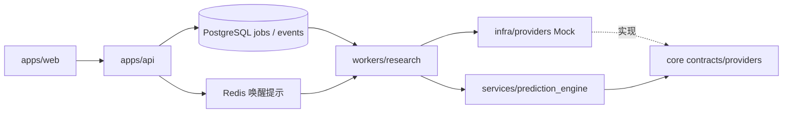

# M0 架构和依赖规则

- Web 仅通过服务端 HTTP 代理访问 API；API 的鉴权令牌不进入客户端 bundle。
- API 管理鉴权、ownership、幂等提交；Worker 执行纯研究接口；Core 只依赖 Pydantic。
- Provider 协议在 Core，具体实现与调用策略在 infra。Core 不依赖 HTTP、数据库、支付、UI。
- 作业以 DB 为事实来源；Redis 只缩短轮询延迟，提交后唤醒失败不会丢失任务。
- Claim 使用条件 UPDATE 和租约 token；失败指数退避，最大三次，过期租约可恢复。
- 同用户幂等键唯一；同键不同输入 409；返回的 request_id 是业务请求，X-Request-ID 是 HTTP trace。
- Outbox/Inbox 在 M0 只处理 DEMO 请求与成功事件，和 job 输出在同一 DB 事务；完整领域消息总线属于 M5。
- 没有预测发布路由；Critic DTO 只能表达 findings，不能提供替换预测指令。真实权限隔离与不可变 DB 版本由 M2/M3 实现。

五对象：ResearchTopic 定义研究范围；WorldForecast 定义稳定目标；ForecastVersion 为不可变版本；
PersonalImpact 绑定用户、画像快照与预测版本；UserReport/Version 固定组合具体版本 ID。
冻结 DTO 使用 frozen + tuple，拒绝额外字段和无时区日期。它不替代未来的 DB 不可变约束。

目录严格沿用第 7.2 节。所有未实现模块保留空包占位；没有增加平行的业务目录树。
数据库只建 `users/jobs/outbox_events/inbox_processed`，未提前创建 M1–M6 表。

测试 `tests/contract/test_boundaries.py` 自动检查 Core 不反向依赖 infra/API。

搜索/抓取供应商已按用户要求选择 DeepSeek（ADR-005）。适配器位于 infra/providers/deepseek.py，
实现 SearchProvider / FetchProvider；它返回未核实候选素材。M0 Worker 仍只由 mock_providers 构造，
不自动读取 DeepSeek Key 或切换到真实检索；Core 与 Web 不包含供应商 SDK 或密钥。

## M1 扩展

用户验收 M0 后进入 M1。infra/evidence_repository.py 负责持久化应用编排，
Core ingestion/evidence/signal_detection 只包含纯 URL/hash/时间/候选标签规则。
新增 M1 来源版本、主张、vintage、候选信号、历史案例和访问审计表；不创建 M2–M6 业务表。
API 管理员手动接入 DeepSeek；Web BFF 需独立管理员 cookie，并且不持有供应商/数据库凭据。
M0 Mock 任务保持可运行；M1 真实资料与 DEMO 均有显式标签，不能进入同一来源簇/指标/信号。
详情以 ADR-006/007 为准。

## M2 扩展

ResearchRepository 在提交时冻结 M1 输入并以外键关联来源/主张/案例/指标版本，长任务复用 jobs 和 Worker。
Core 的 signal_fusion / mechanisms / historical_analogies / forecasting 完成纯结构化工作流，仍无 HTTP/DB 依赖。
研究主题、运行、世界目标、版本结构、草稿 A 和模型审计独立于 API/Web。
草稿、输入和代码/提示词 hash 追加写；发布被数据库触发器阻断，未实现伪 Critic 或用户正式报告。
重放使用保存的响应与已校验的 Core 代码工件，无网络；详情见 ADR-008/009。

## M3 扩展

API 的 ReviewRepository 冻结独立查询的补充证据，将 DTO 交给无凭据、禁止网络/文件访问的独立 Critic 子进程。
五类确定性检查 → Core adjudication 规则 → 追加写审查/裁决。Critic 不持有数据库连接或修订/发布能力。
主引擎根据已核实的问题生成 B1/B2，保存父链、独立输入和字段差分，原 A 不变。
发布在事务内锁定世界目标，绑定最新审查、具体草稿和连续版本号；数据库触发器阻断未过审发布与旧版改写。
评估协议和结果追加写；synthetic/history/forward 分开，未到期和缺数据不算成功。
当前状态、限制和真实前瞻记录以 M3-report.md、ADR-010/011 为准；尚未进入 M4。

## M4 扩展

本地账号/哈希会话通过专用用户 BFF 接入；不回退到静态演示身份。所有画像、报告、建议 API 核对本人 ownership。
Profiles 只向 Core 提供经授权的最小快照；加密和会话/额度/持久化均留在 infra。个人数据不进入 LLM/公共研究。
M4 Worker 复用已发布世界版本，固定 ReportBuildInput；新合成目录仍经过普通 M2/M3 质量门槛。
成功时报告/版本引用/消费 ledger/Job/Outbox 同事务，失败与取消释放。报告与世界预测版本独立，不自动重预测。
详情及限制见 ADR-012/013、M4-report.md；当前不进入 M5。

## M5 扩展

用户已授权 M5。原生 scheduler 检查本地已核实输入，Core turning_points 只做纯差分/分级。
MonitorRepository 冻结监控输入和规则，通过原 M2/M3 生成延续同一目标的世界版本。
updates 只免费重算原报告主题；notifications 管理本人站内通知、偏好、受限本地邮件和退订/退信。
监控、用户报告、邮件各用独立持久化 Job；失败回滚和幂等由租约与事务保障。
详情见 ADR-014、M5-report.md。当前不实施 M6，未开启真实 SMTP 或周期付费服务。

## M6 扩展

用户已授权 M6。billing/paid_research/costs 为 infra 编排，Core 只新增契约 DTO，不引入计费或数据库依赖。
服务端配置冻结 Mock checkout，验签事件与额度入账同事务；套餐 grant/reservation/ledger 与 M4 首次免费权益分离。
规范范围的共享 Mock M2/M3 研究与加密私有报告复用原模块；报告成功后才消费套餐额度，原主题重大更新继续免费。
原生 scheduler 处理另行明确授权的周期研究，不读取邮件开关。新主题、套餐/账单、周期及成本页面走现有鉴权 BFF。
详情见 ADR-015/016、M6-report.md。本地沙盒之外的真实支付/真实定制研究与M7上线验收尚未启用。

## M7 扩展

用户授权 M7 本机工程验收。personal_data/erasure_journal/backup/operations 提供本人删除、恢复与只读就绪观测，Core只增加删除契约DTO。
Migration0011提供带owner登记的窄范围隐私清理例外，不放松公开预测或计费状态约束；删除后会话/待任务不能复活。
固定供应商出口+Fetch域名/DNS约束、流式请求上限、CSP/缓存头、队列预算与DB降级轮询覆盖本轮安全与稳定性专项。
生产发布继续明确阻断，详见ADR-017/018及M7报告；真实供应商和独立人工验收不能由本地自动化代替。

## C端前台与内容分享增量

用户授权公开发现、行业关注/自建管理、报告分享/收藏、聊天研究入口；后台管理保持原业务。apps/api/community与infra/community/conversations负责访问控制、显式公开快照、私人归档与加密对话；Core仅扩展Pydantic契约，不引入HTTP/数据库/页面依赖。Web仍经服务端BFF，公开DTO不含私人报告/画像/对话或身份字段。对话复用原有报告Job与权益，状态来自数据库；新的联网Agent预测规则待用户补充。迁移0015、完整范围与边界见ADR-021和consumer-front-report.md。
